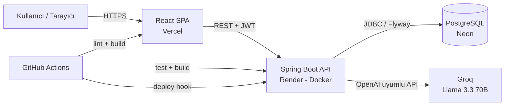
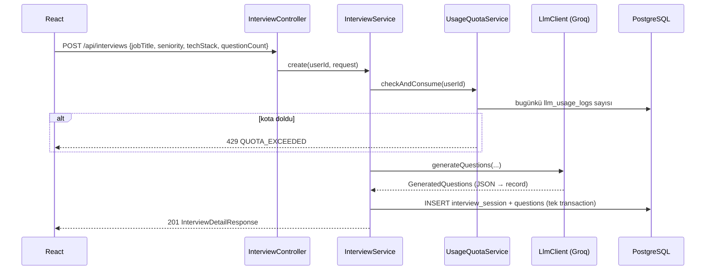
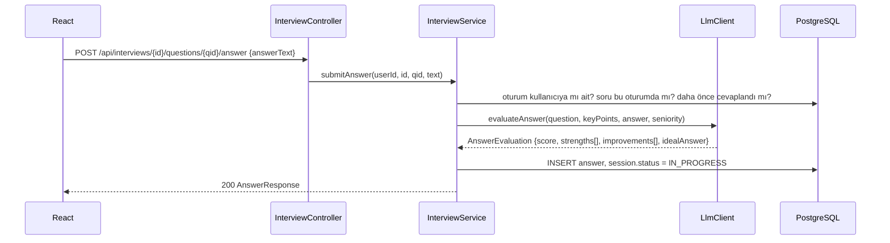
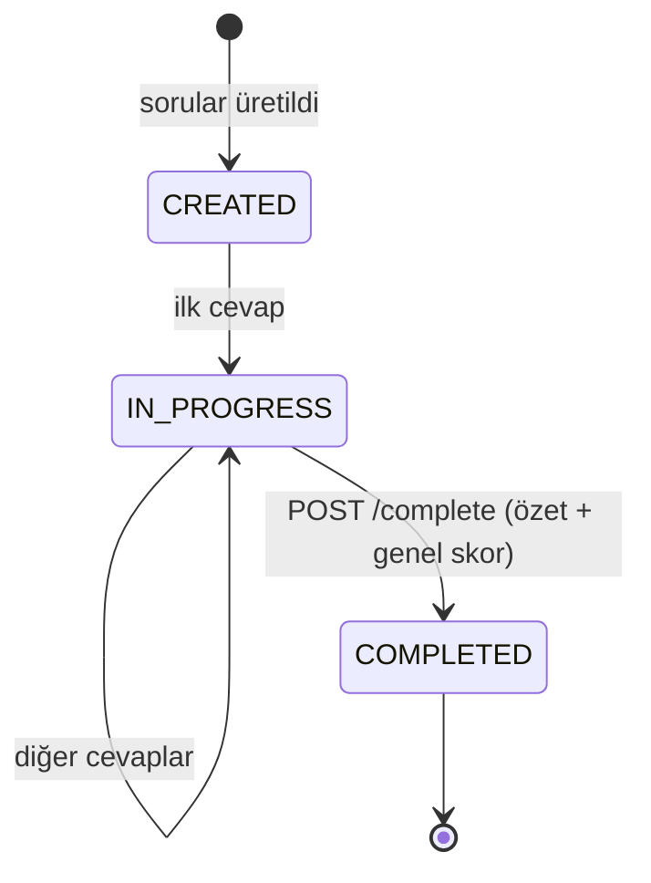

# 2. Mimari

## Genel Bakış



Tek bir Spring Boot servisi (modüler monolit). Mikroservise bölmek bu ölçekte fayda değil maliyet getirir. Mülakatta bunu gerekçesiyle anlatmak da bir artı.

## Teknoloji Seçimleri

### Backend

| Bileşen | Seçim | Neden |
|---|---|---|
| Dil | Java 21 (LTS) | Render/Docker imajları ve kütüphanelerde en yaygın LTS |
| Framework | Spring Boot 4.1.x | Güncel kararlı sürüm |
| LLM istemcisi | Spring AI 2.0.x (`spring-ai-starter-model-openai`) | Groq OpenAI uyumlu; `ChatClient` ile JSON → Java record dönüşümü |
| Veri erişimi | Spring Data JPA (Hibernate) | Standart |
| Migration | Flyway | Şema versiyonlama, `ddl-auto=validate` |
| Güvenlik | Spring Security + JWT (jjwt 0.12+) | Stateless API |
| Validasyon | Jakarta Bean Validation | `@Valid` DTO'lar |
| Dokümantasyon | springdoc-openapi (bonus) | `/swagger-ui.html` |
| Test | JUnit 5, Mockito, Testcontainers, MockMvc | Gerçek PostgreSQL ile entegrasyon testi |
| Build | Maven (wrapper) | Initializr varsayılanı |

Spring Initializr (<https://start.spring.io>) ayarları:
Project: **Maven**, Language: **Java**, Spring Boot: **4.1.x**, Group: `com.interviewpilot`, Artifact: `backend`, Packaging: Jar, Java: **21**.
Bağımlılıklar: *Spring Web, Spring Data JPA, PostgreSQL Driver, Flyway Migration, Validation, Spring Security, Spring Boot Actuator, Lombok (opsiyonel), Testcontainers, OpenAI (Spring AI)*.

### Frontend

| Bileşen | Seçim |
|---|---|
| Build aracı | Vite (`npm create vite@latest frontend -- --template react-ts`) |
| UI | Tailwind CSS + shadcn/ui |
| Routing | React Router |
| Sunucu durumu | TanStack Query |
| HTTP | axios (interceptor ile JWT ekleme, 401'de logout) |
| Form | react-hook-form + zod |
| Grafik | recharts (panel istatistikleri) |
| Test | Vitest + Testing Library |

## Backend Paket Yapısı (feature bazlı)

Katman bazlı (`controller/`, `service/` ...) yerine **özellik bazlı** paketleme: her özellik kendi içinde bütün.

```
backend/src/main/java/com/interviewpilot/
├── InterviewPilotApplication.java
├── config/
│   ├── SecurityConfig.java          # filter chain, CORS, public endpoint'ler
│   ├── CorsProperties.java          # app.cors.allowed-origins
│   └── LlmConfig.java               # ChatClient bean'i, mock/gerçek seçimi
├── auth/
│   ├── AuthController.java          # /api/auth/register, /login, /me
│   ├── AuthService.java
│   ├── JwtService.java              # token üret / doğrula
│   ├── JwtAuthenticationFilter.java # OncePerRequestFilter
│   └── dto/ (RegisterRequest, LoginRequest, AuthResponse, UserResponse)
├── user/
│   ├── User.java                    # @Entity
│   ├── UserRepository.java
│   └── Role.java                    # enum USER, ADMIN
├── interview/
│   ├── InterviewController.java     # /api/interviews/**
│   ├── InterviewService.java        # iş kuralları, durum geçişleri
│   ├── InterviewSession.java        # @Entity
│   ├── Question.java                # @Entity
│   ├── Answer.java                  # @Entity
│   ├── *Repository.java
│   ├── SessionStatus.java, Seniority.java, QuestionCategory.java ...
│   └── dto/ (CreateInterviewRequest, InterviewDetailResponse, SubmitAnswerRequest, ...)
├── llm/
│   ├── LlmClient.java               # interface: generateQuestions, evaluateAnswer, summarize
│   ├── GroqLlmClient.java           # Spring AI ChatClient ile gerçek implementasyon
│   ├── MockLlmClient.java           # API anahtarı yokken / testlerde
│   ├── PromptTemplates.java         # prompt metinleri (veya resources/prompts/*.st)
│   ├── UsageQuotaService.java       # günlük kota kontrolü
│   ├── LlmUsageLog.java + Repository
│   └── dto/ (GeneratedQuestions, AnswerEvaluation, SessionSummary)  # Java record
├── stats/
│   ├── StatsController.java         # /api/stats/me
│   └── StatsService.java
└── common/
    ├── exception/ (GlobalExceptionHandler, ApiError, NotFoundException,
    │               QuotaExceededException, LlmUnavailableException, ...)
    └── BaseEntity.java              # id, createdAt, updatedAt (@MappedSuperclass)
```

```
backend/src/main/resources/
├── application.yml
├── application-prod.yml
└── db/migration/V1__init_schema.sql   # docs/sql/ altından kopyala
```

## Frontend Klasör Yapısı

```
frontend/src/
├── main.tsx, App.tsx            # QueryClientProvider, RouterProvider
├── lib/
│   ├── api.ts                   # axios instance (baseURL = import.meta.env.VITE_API_URL)
│   ├── auth.tsx                 # AuthContext: token, user, login(), logout()
│   └── utils.ts                 # shadcn cn()
├── components/
│   ├── ui/                      # shadcn bileşenleri (button, card, input, textarea, badge, progress, toast...)
│   ├── layout/ (AppShell, Navbar, ProtectedRoute)
│   └── interview/ (QuestionCard, EvaluationPanel, ScoreBadge, SessionListItem)
├── features/
│   ├── auth/ (LoginPage, RegisterPage, schemas.ts)
│   ├── interviews/ (NewInterviewPage, InterviewPage, InterviewResultPage, HistoryPage, api.ts, hooks.ts)
│   └── dashboard/ (DashboardPage, StatsCards, CategoryChart)
└── types/api.ts                 # backend DTO'larının TypeScript karşılıkları
```

### Sayfalar ve Rotalar

| Rota | Sayfa | Korumalı |
|---|---|---|
| `/` | Landing (ne işe yarar, "Hemen dene" butonu) | Hayır |
| `/login`, `/register` | Giriş / kayıt | Hayır |
| `/dashboard` | İstatistik kartları, son mülakatlar | Evet |
| `/interviews/new` | Yeni mülakat formu | Evet |
| `/interviews/:id` | Soru-cevap ekranı (ilerleme çubuğu, soru kartı, değerlendirme) | Evet |
| `/interviews/:id/result` | Genel skor, özet, tüm sorular/cevaplar | Evet |
| `/history` | Geçmiş mülakatlar (sayfalı) | Evet |

Her sayfada **loading** (skeleton), **empty** ("Henüz mülakatın yok — ilkini başlat") ve **error** (tekrar dene butonu) durumlarını ele al. LLM çağrıları 3–10 sn sürebilir; butonda spinner + "Sorular hazırlanıyor..." metni göster.

## Ana Akışlar

### Mülakat oluşturma



> Önemli: LLM çağrısını **DB transaction'ının dışında** yap (önce LLM, sonra `@Transactional` kaydetme metodu). Aksi halde 10 saniyelik HTTP çağrısı boyunca DB bağlantısı kilitli kalır. Mülakatta anlatılacak güzel bir detay.

### Cevap değerlendirme



### Oturum durum makinesi



`COMPLETED` oturuma yeni cevap gönderilirse `409 CONFLICT`.

## Güvenlik Notları

- Şifreler `BCryptPasswordEncoder` ile hash'lenir.
- JWT secret en az 256 bit (32+ karakter), **sadece** ortam değişkeninden okunur.
- Her sorguda sahiplik kontrolü: `findByIdAndUserId(...)` — başkasının oturumuna erişim `404` döner (varlığını sızdırmamak için 403 değil).
- CORS'ta sadece frontend domain'ine izin verilir (`APP_CORS_ALLOWED_ORIGINS`).
- Kullanıcı girdisi prompt'a eklenirken uzunluk sınırı uygulanır (prompt injection ve token maliyeti için), bkz. [LLM dokümanı](05-llm-entegrasyonu.md).
- API anahtarları asla frontend'e veya repoya girmez.

## Konfigürasyon (`application.yml` örneği)

```yaml
server:
  port: ${PORT:8087}

spring:
  application:
    name: interviewpilot
  datasource:
    url: ${DB_URL:jdbc:postgresql://localhost:5432/interviewpilot_db}
    username: ${DB_USERNAME:interviewpilot_app}
    password: ${DB_PASSWORD}
    hikari:
      maximum-pool-size: 5          # Neon ücretsiz planı için küçük tut
  jpa:
    hibernate:
      ddl-auto: validate            # şemayı sadece Flyway yönetir
    open-in-view: false
  flyway:
    enabled: true
  ai:
    openai:
      api-key: ${GROQ_API_KEY:missing}
      base-url: https://api.groq.com/openai/v1
      chat:
        model: ${LLM_MODEL:llama-3.3-70b-versatile}
        temperature: 0.4
        max-tokens: 1500
  # Spring AI'ın kendi retry'ı varsayılan olarak 10 deneme ve dakikalarca bekleme yapar; API isteğini kilitlememesi için kıs
  retry:
    max-attempts: 2
    backoff:
      initial-interval: 1s
      max-interval: 3s

app:
  jwt:
    secret: ${JWT_SECRET}
    expiration-minutes: 1440
  cors:
    allowed-origins: ${APP_CORS_ALLOWED_ORIGINS:http://localhost:5199}
  llm:
    provider: ${LLM_PROVIDER:groq}        # groq | mock
    daily-limit-per-user: ${LLM_DAILY_LIMIT:15}
    global-daily-limit: ${LLM_GLOBAL_DAILY_LIMIT:300}
    fallback-model: llama-3.1-8b-instant
    max-answer-chars: 4000

management:
  endpoints:
    web:
      exposure:
        include: health,info
```

> Property adları Spring AI 2.0.x'e göredir (Spring AI 1.x'teki `chat.options.model` yerine 2.0'da `chat.model` kullanılır). Kurulumdan sonra [Spring AI Groq referansını](https://docs.spring.io/spring-ai/reference/api/chat/groq-chat.html) kontrol et. Groq için `base-url` değeri `https://api.groq.com/openai/v1` olmalıdır.
