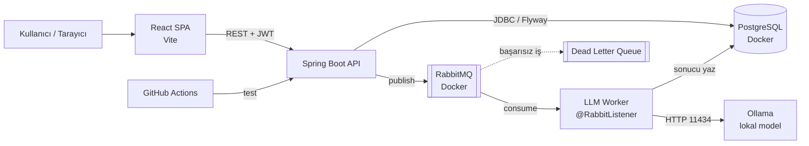
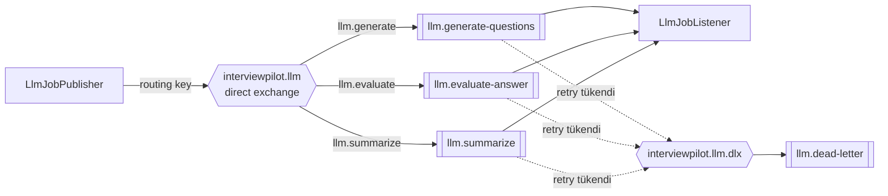
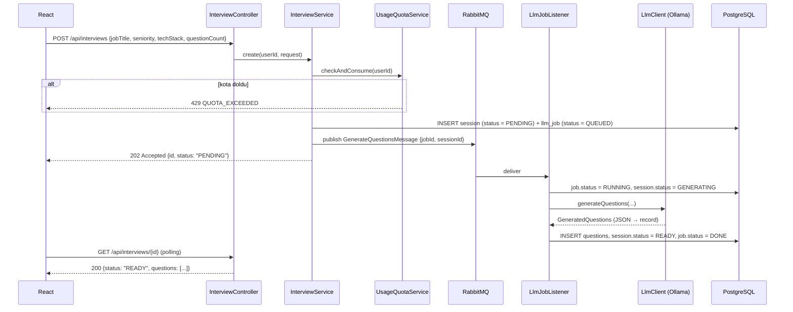
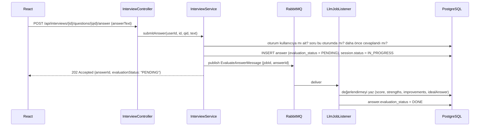
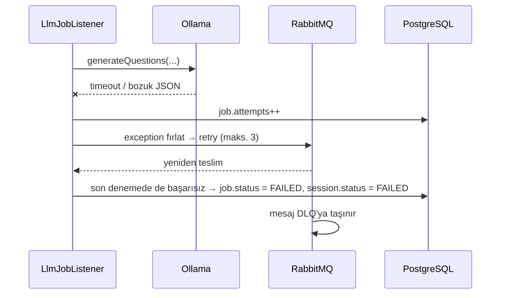
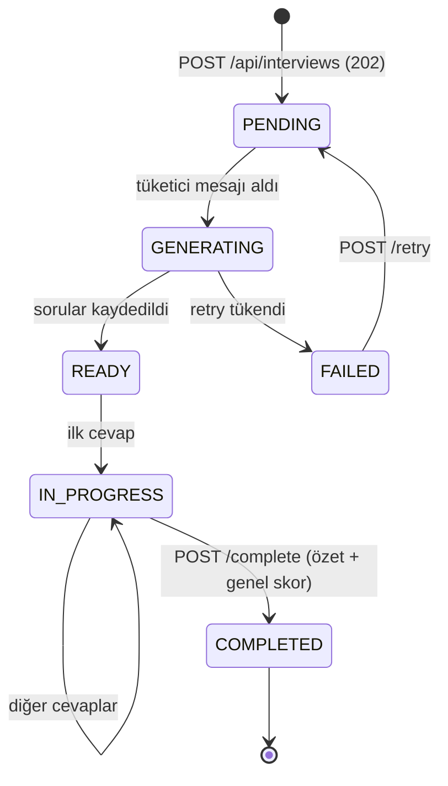

# 2. Mimari

## Genel Bakış



Tek bir Spring Boot servisi (modüler monolit). Worker ayrı bir process değil, aynı uygulamanın içindeki bir `@RabbitListener`. Mikroservise bölmek bu ölçekte fayda değil maliyet getirir — mülakatta bu kararı gerekçesiyle anlatmak bir artı.

Her şey lokal çalışır: PostgreSQL ve RabbitMQ Docker'da, Ollama doğrudan işletim sisteminde. Dış servis, API anahtarı ve internet bağlantısı gerekmez.

## Teknoloji Seçimleri

### Backend

| Bileşen | Seçim | Neden |
|---|---|---|
| Dil | Java 21 (LTS) | Güncel LTS, kütüphane desteği en geniş |
| Framework | Spring Boot 4.1.x | Güncel kararlı sürüm |
| LLM çalıştırma | **Ollama** (lokal) | Tamamen ücretsiz, API anahtarı ve internet gerekmez, veriler makineden çıkmaz |
| LLM istemcisi | Spring AI 2.0.x (`spring-ai-starter-model-ollama`) | `ChatClient` + `.entity()` ile JSON → Java record |
| Mesajlaşma | **RabbitMQ** + Spring AMQP | Yavaş LLM çağrısını HTTP isteğinden ayırmak; DLQ ve retry yerleşik |
| Veri erişimi | Spring Data JPA (Hibernate) | Standart |
| Migration | Flyway | Şema versiyonlama, `ddl-auto=validate` |
| Güvenlik | Spring Security + JWT (jjwt 0.12+) | Stateless API |
| Validasyon | Jakarta Bean Validation | `@Valid` DTO'lar |
| Dokümantasyon | springdoc-openapi (bonus) | `/swagger-ui.html` |
| Test | JUnit 5, Mockito, Testcontainers, MockMvc | Gerçek PostgreSQL ve RabbitMQ ile entegrasyon testi |
| Build | Maven (wrapper) | Initializr varsayılanı |

**Neden Kafka değil RabbitMQ?** Buradaki ihtiyaç bir *iş kuyruğu*: bir görev üretilir, bir tüketici işler, sonuç veritabanına yazılır. Kafka event streaming için tasarlanmış; bu senaryoda dead letter queue'yu elle kurman, daha fazla kaynak ayırman ve daha karmaşık bir tüketici modeli yönetmen gerekirdi. RabbitMQ'da DLX (dead letter exchange), retry ve prefetch kontrolü kutudan çıkıyor. Mülakatta "neden Kafka değil?" sorusuna verilecek cevap budur.

Spring Initializr (<https://start.spring.io>) ayarları:
Project: **Maven**, Language: **Java**, Spring Boot: **4.1.x**, Group: `com.interviewpilot`, Artifact: `backend`, Packaging: Jar, Java: **21**.
Bağımlılıklar: *Spring Web, Spring Data JPA, PostgreSQL Driver, Flyway Migration, Validation, Spring Security, Spring Boot Actuator, **Spring for RabbitMQ**, Lombok (opsiyonel), Testcontainers, **Ollama (Spring AI)***.

### Frontend

| Bileşen | Seçim |
|---|---|
| Build aracı | Vite (`npm create vite@latest frontend -- --template react-ts`) |
| UI | Tailwind CSS + shadcn/ui |
| Routing | React Router |
| Sunucu durumu | TanStack Query (asenkron işler için `refetchInterval` ile polling) |
| HTTP | axios (interceptor ile JWT ekleme, 401'de logout) |
| Form | react-hook-form + zod |
| Grafik | recharts (panel istatistikleri) |
| Test | Vitest + Testing Library |

## Backend Paket Yapısı (feature bazlı)

Katman bazlı (`controller/`, `service/` ...) yerine **özellik bazlı** paketleme: her özellik kendi içinde bütün.

```
src/main/java/com/interviewpilot/backend/
├── BackendApplication.java
├── config/
│   ├── SecurityConfig.java          # filter chain, CORS, public endpoint'ler
│   ├── CorsProperties.java          # app.cors.allowed-origins
│   └── LlmConfig.java               # ChatClient bean'i, ollama/mock seçimi
├── auth/
│   ├── AuthController.java          # /api/auth/register, /login, /me
│   ├── AuthService.java
│   ├── JwtService.java              # token üret / doğrula
│   ├── JwtAuthenticationFilter.java # OncePerRequestFilter
│   └── dto/ (RegisterRequest, LoginRequest, AuthResponse, UserResponse)
├── user/
│   ├── User.java                    # @Entity
│   ├── UserRepository.java
│   └── Role.java                    # enum USER, ADMIN
├── interview/
│   ├── InterviewController.java     # /api/interviews/**
│   ├── InterviewService.java        # iş kuralları, durum geçişleri
│   ├── InterviewSession.java        # @Entity
│   ├── Question.java                # @Entity
│   ├── Answer.java                  # @Entity
│   ├── *Repository.java
│   ├── SessionStatus.java, EvaluationStatus.java, Seniority.java, QuestionCategory.java ...
│   └── dto/ (CreateInterviewRequest, InterviewDetailResponse, SubmitAnswerRequest, ...)
├── messaging/
│   ├── RabbitConfig.java            # exchange, queue, DLX, binding, converter
│   ├── LlmJobPublisher.java         # işi kuyruğa koyar
│   ├── LlmJobListener.java          # @RabbitListener — LLM çağrısı burada yapılır
│   └── dto/ (GenerateQuestionsMessage, EvaluateAnswerMessage, SummarizeMessage)
├── llm/
│   ├── LlmClient.java               # interface: generateQuestions, evaluateAnswer, summarizeSession
│   ├── OllamaLlmClient.java         # Spring AI ChatClient ile gerçek implementasyon
│   ├── MockLlmClient.java           # Ollama yokken / CI'da / testlerde
│   ├── LlmResponseValidator.java    # clamp, enum fallback, JSON temizleme
│   ├── PromptTemplates.java         # veya resources/prompts/*.st
│   ├── UsageQuotaService.java       # günlük kullanım sınırı
│   ├── LlmJob.java + LlmJobRepository        # işin durumu, deneme sayısı, hata
│   ├── LlmUsageLog.java + Repository
│   └── dto/ (GeneratedQuestions, AnswerEvaluation, SessionSummary)  # Java record
├── stats/
│   ├── StatsController.java         # /api/stats/me
│   └── StatsService.java
└── common/
    ├── exception/ (GlobalExceptionHandler, ApiError, NotFoundException,
    │               QuotaExceededException, LlmUnavailableException, ...)
    └── BaseEntity.java              # id, createdAt, updatedAt (@MappedSuperclass)
```

```
src/main/resources/
├── application.properties            # ortak ayarlar
├── application-local.properties      # lokal geliştirme
├── prompts/                          # *.st şablonları
└── db/migration/V1__init_schema.sql  # docs/sql/ altından kopyala
```

## Frontend Klasör Yapısı

```
frontend/src/
├── main.tsx, App.tsx            # QueryClientProvider, RouterProvider
├── lib/
│   ├── api.ts                   # axios instance (baseURL = import.meta.env.VITE_API_URL)
│   ├── auth.tsx                 # AuthContext: token, user, login(), logout()
│   └── utils.ts                 # shadcn cn()
├── components/
│   ├── ui/                      # shadcn bileşenleri
│   ├── layout/ (AppShell, Navbar, ProtectedRoute)
│   └── interview/ (QuestionCard, EvaluationPanel, ScoreBadge, SessionListItem, JobStatusBanner)
├── features/
│   ├── auth/ (LoginPage, RegisterPage, schemas.ts)
│   ├── interviews/ (NewInterviewPage, InterviewPage, InterviewResultPage, HistoryPage, api.ts, hooks.ts)
│   └── dashboard/ (DashboardPage, StatsCards, CategoryChart)
└── types/api.ts                 # backend DTO'larının TypeScript karşılıkları
```

### Sayfalar ve Rotalar

| Rota | Sayfa | Korumalı |
|---|---|---|
| `/` | Landing (ne işe yarar, "Hemen dene" butonu) | Hayır |
| `/login`, `/register` | Giriş / kayıt | Hayır |
| `/dashboard` | İstatistik kartları, son mülakatlar | Evet |
| `/interviews/new` | Yeni mülakat formu | Evet |
| `/interviews/:id` | Soru-cevap ekranı (ilerleme çubuğu, soru kartı, değerlendirme) | Evet |
| `/interviews/:id/result` | Genel skor, özet, tüm sorular/cevaplar | Evet |
| `/history` | Geçmiş mülakatlar (sayfalı) | Evet |

Her sayfada **loading** (skeleton), **empty** ("Henüz mülakatın yok — ilkini başlat"), **error** (tekrar dene butonu) ve **bekleyen iş** durumlarını ele al. Lokal modelde soru üretimi 30–90 sn sürebilir; kullanıcıya ilerleme hissi veren bir ekran şart (bkz. [Polling](#polling-stratejisi)).

## Mesajlaşma Topolojisi



| Ayar | Değer | Neden |
|---|---|---|
| Exchange | `interviewpilot.llm` (direct) | Üç iş tipi ayrı routing key ile ayrılır |
| Kuyruklar | `llm.generate-questions`, `llm.evaluate-answer`, `llm.summarize` | İş tipleri birbirini bloklamasın |
| DLX | `interviewpilot.llm.dlx` → `llm.dead-letter` | Başarısız işler kaybolmaz, incelenebilir |
| `concurrency` | **1** | Ollama aynı anda tek isteği makul hızda işler; paralellik her şeyi yavaşlatır |
| `prefetch` | 1 | Tüketici sırada bekleyen mesajları rezerve etmesin |
| Retry | 3 deneme, 2s → 10s backoff | Geçici hatalar (model yükleniyor) kendiliğinden düzelsin |
| Mesaj içeriği | Sadece `jobId` ve kimlikler | Mesaj küçük kalsın, gerçek veri DB'den okunsun |

**Idempotency:** Tüketici her mesajda önce `llm_jobs` kaydının durumuna bakar. `DONE` ise hiçbir şey yapmadan ACK'lar. RabbitMQ en az bir kez teslim garantisi verdiği için aynı mesaj iki kez gelebilir; bu kontrol olmadan aynı soru seti iki kez üretilir.

**Mesaj içine entity koyma.** Sadece `jobId`, `sessionId`, `questionId` gönder. Böylece mesaj formatı entity değişikliklerinden etkilenmez ve kuyrukta bekleyen eski mesajlar bozulmaz.

## Ana Akışlar

### Mülakat oluşturma (asenkron)



> Kritik nokta: LLM çağrısı hem **HTTP isteğinin** hem de **DB transaction'ının** dışında. Önce hızlı bir transaction'la kayıt atılıp mesaj yayınlanıyor, uzun süren çağrı tüketicide yapılıyor, sonuç ayrı bir transaction'da yazılıyor. 60 saniyelik bir model çağrısı boyunca ne kullanıcı bekliyor ne de DB bağlantısı kilitli kalıyor. Mülakatta anlatılacak en güçlü detay bu.

### Cevap değerlendirme (asenkron)



Kullanıcı cevabı gönderdikten sonra bir sonraki soruya geçebilir; değerlendirme hazır olunca ekranda belirir. Bu, senkron tasarıma göre çok daha akıcı bir deneyim.

### Hata ve tekrar deneme



Kullanıcı `FAILED` durumundaki oturumda "Tekrar dene" butonunu görür; bu `POST /api/interviews/{id}/retry` çağrısıyla yeni bir iş kuyruğa koyar.

### Oturum durum makinesi



| Durum | Anlamı |
|---|---|
| `PENDING` | Kuyrukta, henüz işlenmedi |
| `GENERATING` | Tüketici soruları üretiyor |
| `READY` | Sorular hazır, cevaplanabilir |
| `IN_PROGRESS` | En az bir cevap verildi |
| `COMPLETED` | Özet ve genel skor üretildi |
| `FAILED` | LLM işi kalıcı olarak başarısız |

`COMPLETED` oturuma yeni cevap gönderilirse `409 CONFLICT`. `PENDING` / `GENERATING` / `FAILED` durumundaki oturuma cevap gönderilirse `409 SESSION_NOT_READY`.

## Polling Stratejisi

Asenkron akışta frontend sonucu nasıl öğrenecek? Bu projede **polling** yeterli:

- TanStack Query'de `refetchInterval`: durum `PENDING` veya `GENERATING` ise 2 sn, `READY`/`COMPLETED`/`FAILED` ise `false`.
- 2 dakika sonra hâlâ bitmediyse polling'i durdur, "Beklenenden uzun sürüyor" mesajı göster.
- Cevap değerlendirmesi için aynı mantık `evaluationStatus` üzerinden.

WebSocket veya SSE daha zarif olurdu ama tek kullanıcılı lokal bir uygulamada karmaşıklığı hak etmiyor. Mülakatta sorulursa: "Ölçek gerekseydi SSE ya da STOMP over WebSocket kullanırdım; burada polling'in maliyeti 2 saniyede bir tek satırlık bir sorgu."

## Güvenlik Notları

- Şifreler `BCryptPasswordEncoder` ile hash'lenir.
- JWT secret en az 256 bit (32+ karakter), **sadece** ortam değişkeninden okunur.
- Her sorguda sahiplik kontrolü: `findByIdAndUserId(...)` — başkasının oturumuna erişim `404` döner (varlığını sızdırmamak için 403 değil).
- Kuyruğa mesaj koyarken de sahiplik kontrolü API katmanında yapılır; tüketici mesaja güvenir ama yine de `userId` eşleşmesini doğrular.
- CORS'ta sadece frontend origin'ine izin verilir (`APP_CORS_ALLOWED_ORIGINS`).
- Kullanıcı girdisi prompt'a eklenirken uzunluk sınırı uygulanır (prompt injection ve süre maliyeti için), bkz. [LLM dokümanı](05-llm-entegrasyonu.md).
- RabbitMQ management arayüzü (15672) varsayılan `guest/guest` ile açılır; `.env`'den kendi kullanıcı adını/şifreni ver.

## Konfigürasyon (`application.yml` örneği)

```yaml
server:
  port: ${PORT:8087}

spring:
  application:
    name: interviewpilot
  datasource:
    url: ${DB_URL:jdbc:postgresql://localhost:5435/interviewpilot_db}
    username: ${DB_USERNAME:interviewpilot_app}
    password: ${DB_PASSWORD}
    hikari:
      maximum-pool-size: 10
  jpa:
    hibernate:
      ddl-auto: validate            # şemayı sadece Flyway yönetir
    open-in-view: false
  flyway:
    enabled: true

  rabbitmq:
    host: ${RABBITMQ_HOST:localhost}
    port: ${RABBITMQ_PORT:5672}
    username: ${RABBITMQ_USER:interviewpilot}
    password: ${RABBITMQ_PASSWORD}
    listener:
      simple:
        concurrency: 1              # Ollama tek isteği işler
        max-concurrency: 1
        prefetch: 1
        default-requeue-rejected: false   # reddedilen mesaj DLQ'ya gitsin
        retry:
          enabled: true
          max-attempts: 3
          initial-interval: 2s
          max-interval: 10s
          multiplier: 2

  ai:
    ollama:
      base-url: ${OLLAMA_BASE_URL:http://localhost:11434}
      init:
        pull-model-strategy: never  # modeli elle `ollama pull` ile indir
      chat:
        options:
          model: ${LLM_MODEL:llama3.2:3b}
          temperature: 0.4
          num-predict: 1500         # max token karşılığı
          num-ctx: 4096
          format: json              # modeli JSON dışına çıkmaya zorlamaz ama güçlü şekilde yönlendirir

app:
  jwt:
    secret: ${JWT_SECRET}
    expiration-minutes: 1440
  cors:
    allowed-origins: ${APP_CORS_ALLOWED_ORIGINS:http://localhost:5199}
  llm:
    provider: ${LLM_PROVIDER:ollama}      # ollama | mock
    daily-limit-per-user: ${LLM_DAILY_LIMIT:50}
    global-daily-limit: ${LLM_GLOBAL_DAILY_LIMIT:500}
    timeout-seconds: ${LLM_TIMEOUT_SECONDS:120}
    max-answer-chars: 4000

management:
  endpoints:
    web:
      exposure:
        include: health,info
  endpoint:
    health:
      show-details: when-authorized
```

Notlar:

- Spring AI'ın Ollama starter'ında seçenekler `spring.ai.ollama.chat.options.*` altında; OpenAI starter'ındaki `chat.model` yapısıyla karıştırma. Kurulumdan sonra [Spring AI Ollama referansını](https://docs.spring.io/spring-ai/reference/api/chat/ollama-chat.html) kontrol et.
- Lokal modelde 120 saniyelik zaman aşımı makul. Bu değer asenkron tüketicide kullanıldığı için kullanıcıyı bekletmiyor; senkron bir API'de kabul edilemez olurdu.
- Kota sınırları Groq'a göre yüksek tutuldu (parasal maliyet yok), sadece tek kullanıcının kuyruğu doldurmasını engelliyor.
- `pull-model-strategy: never` — Spring'in açılışta model indirmeye çalışıp uygulamayı dakikalarca bekletmesini engeller. Modeli sen `ollama pull` ile indirirsin.
