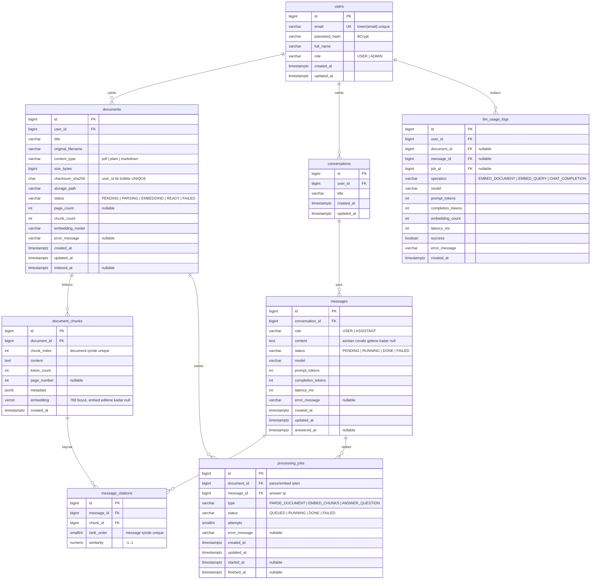

# 3. Veritabanı

PostgreSQL 16 + **pgvector** (lokalde Docker). Şemayı **sadece Flyway** yönetir; Hibernate `ddl-auto: validate` modunda çalışır.
Referans şema: [`docs/sql/V1__init_schema.sql`](sql/V1__init_schema.sql). Dosya `src/main/resources/db/migration/` altına gider.

> **Docker imajı değişmeli.** `postgres:16-alpine` pgvector içermez; migration `CREATE EXTENSION vector` satırında düşer. `docker-compose.yml`'da imajı **`pgvector/pgvector:pg16`** yap.

Şema baştan **asenkron akışa** göre tasarlandı: bir doküman, chunk'ları çıkarılmadan önce var olur; bir chunk, embedding'i üretilmeden önce kaydedilir; bir asistan mesajı, cevabı gelmeden önce satır olarak durur. Bu yüzden `embedding`, `content`, `score` gibi alanlar nullable ve her varlığın bir durum kolonu var.

## ER Diyagramı



## İlişkiler

| İlişki | Tür | Silme davranışı | Açıklama |
|---|---|---|---|
| `users` → `documents` | 1 – N | `CASCADE` | Kullanıcının dokümanları |
| `documents` → `document_chunks` | 1 – 0..N | `CASCADE` | Chunk'lar parse aşamasında oluşur; `PENDING` dokümanın chunk'ı yoktur |
| `documents` → `processing_jobs` | 1 – N | `CASCADE` | Parse ve embed işleri, tekrar denemeler dahil |
| `users` → `conversations` | 1 – N | `CASCADE` | Sohbetler |
| `conversations` → `messages` | 1 – N | `CASCADE` | Mesajlar |
| `messages` → `message_citations` | 1 – 0..N | `CASCADE` | Asistan cevabının kaynakları |
| `document_chunks` → `message_citations` | 1 – 0..N | `CASCADE` | Doküman silinirse eski cevapların alıntıları da gider |
| `messages` → `processing_jobs` | 1 – N | `CASCADE` | Cevap üretme işi |
| `users` → `llm_usage_logs` | 1 – N | `CASCADE` | Kota ve gecikme istatistiği |
| `documents` / `messages` → `llm_usage_logs` | 1 – N | `SET NULL` | Kaynak silinse de kullanım kaydı kalır (kota atlatılamasın) |

> `message_citations` → `document_chunks` ilişkisinde `CASCADE` bilinçli bir tercih. Doküman silindiğinde eski cevaplardaki kaynak bağlantıları da kaybolur, cevap metni kalır. Alternatif `SET NULL` olurdu ama o zaman "bu cevap neye dayanıyordu?" sorusuna yanıt veremeyen yarım kayıtlar oluşurdu. Mülakatta sorulursa: "kaynak metni de saklamak isterdim, o zaman `citations` tablosuna `content_snapshot` kolonu eklerdim."

## Tablolar ve Tasarım Kararları

### `users`
- E-posta benzersizliği `LOWER(email)` üzerinde fonksiyonel indeksle. Servis katmanında da kaydetmeden önce küçük harfe çevir.
- `role` DB'de `VARCHAR` + `CHECK`, JPA'da `EnumType.STRING`. Native enum yerine bu tercih edildi çünkü yeni değer eklemek migration'da daha kolay.

### `documents`
- Dosyanın **kendisi veritabanında değil**, diskte (`storage_path`). PostgreSQL'e 20 MB'lık PDF'ler yazmak yedekleme ve bellek açısından kötü; blob yerine dosya sistemi doğru araç. `storage_path` göreli tutulur ki klasörü taşıyabilsin.
- `checksum_sha256` + `user_id` üzerinde **UNIQUE**. Aynı kullanıcı aynı dosyayı ikinci kez yüklerse `409` alır; böylece yüzlerce embedding çağrısı boşa gitmez. Bu kısıt aynı zamanda RAG'in en sinir bozucu problemini engeller: aynı içeriğin iki kez indekslenmesi sonucu arama sonuçlarının aynı metinle dolması.
- `status` beş değerli durum makinesi; varsayılan `PENDING`.
- `chunk_count` ve `page_count` denormalize — her liste isteğinde `COUNT(*)` atmamak için. Embedding bitince yazılır.
- `embedding_model` hangi modelle indekslendiğini saklar. Model değiştirirsen hangi dokümanların yeniden indekslenmesi gerektiğini bu kolondan bulursun.
- `ix_documents_status_created` indeksi "takılı kalmış" dokümanları (uygulama çökmüşse `PARSING`'de kalanlar) bulmak için.

### `document_chunks`
- **Projenin kalbi.** `embedding VECTOR(768)` kolonu pgvector tipinde.
- `embedding` **nullable**: chunk parse aşamasında yazılır, embedding sonra gelir. `ix_chunks_pending_embedding` kısmi indeksi (`WHERE embedding IS NULL`) yarı kalmış indekslemeyi kaldığı yerden sürdürmeyi mümkün kılar.
- `(document_id, chunk_index)` UNIQUE — sıra garantisi ve tekrar işlemede çakışma koruması.
- `page_number` kaynak gösterimi için kritik: kullanıcıya "sayfa 12" diyebilmek cevabı doğrulanabilir kılar. PDF okurken sayfa bilgisini kaybetme.
- `metadata` JSONB — başlık, bölüm adı gibi ileride eklenecek alanlar için esneklik. Şu an boş dizi/nesne.
- `token_count` prompt'a kaç chunk sığdırabileceğini hesaplamak için.

**HNSW indeksi:**

```sql
CREATE INDEX ix_chunks_embedding_hnsw ON document_chunks
    USING hnsw (embedding vector_cosine_ops);
```

- HNSW (Hierarchical Navigable Small World) yaklaşık en yakın komşu indeksi. `ivfflat`'a göre daha yüksek doğruluk ve sorgu hızı sunar, karşılığında indeks oluşturma daha yavaş ve daha fazla bellek ister. Bu ölçekte doğru tercih.
- `vector_cosine_ops` → `<=>` operatörü (kosinüs uzaklığı). Operatör sınıfı ile sorgudaki operatör **eşleşmezse indeks kullanılmaz**; `<->` (L2) yazarsan sequential scan alırsın.
- Boş tabloda indeks oluşturmak sorun değil; pgvector satırlar eklendikçe indeksi günceller.

### `conversations` / `messages`
- Sohbet geçmişi klasik bir yapı, tek özelliği asistan mesajının **asenkron dolması**.
- `content` nullable; `chk_messages_done_content` kısıtı "DONE ise içerik dolu olmalı" kuralını veritabanı seviyesinde garanti eder. Uygulamadaki bir hata yüzünden boş cevap kaydı oluşamaz.
- `chk_messages_user_done` kullanıcı mesajının her zaman tamamlanmış ve dolu olmasını zorlar — kullanıcı mesajı asenkron bir şey beklemez.
- `model`, `prompt_tokens`, `completion_tokens`, `latency_ms` her cevapta doldurulur. Bu, "hangi model ne kadar sürede cevap verdi?" sorusunu cevaplar ve README'ye koyacağın ölçümleri sağlar.
- `conversations.updated_at` son mesajla güncellenir; liste bu kolona göre sıralanır (`ix_conversations_user_updated`).

### `message_citations`
- RAG'i basit bir chatbot'tan ayıran tablo. Her asistan cevabı için kullanılan chunk'lar, sırası ve benzerlik skoru.
- `rank_order` 1'den başlar, `(message_id, rank_order)` UNIQUE. Kullanıcıya "[1]", "[2]" şeklinde numaralı kaynak göstermeyi ve prompt'taki numaralarla eşleştirmeyi sağlar.
- `similarity NUMERIC(6,5)` — kosinüs benzerliği `-1..1`. Saklamanın değeri: sonradan "hangi eşik doğru?" sorusunu **veriyle** cevaplayabilirsin (bkz. [bakım sorguları](#i̇şe-yarayan-bakım-sorguları)).
- `rank` yerine `rank_order` kullanıldı; `rank` PostgreSQL'de pencere fonksiyonu adı olduğu için kolon adı olarak karışıklık yaratıyor.

### `processing_jobs`
- Kuyruğa atılan her işin kalıcı izi. RabbitMQ mesajı uçucudur; bu tablo "ne oldu?" sorusunun cevabı.
- `chk_jobs_target` kısıtı: `PARSE_DOCUMENT` / `EMBED_CHUNKS` işleri bir dokümana, `ANSWER_QUESTION` işi bir mesaja bağlı olmalı; ikisi birden veya hiçbiri olamaz. Bu tür koşullu zorunluluk kısıtları mülakatta anlatılabilecek bir detay.
- `attempts` her denemede artar; `status = FAILED` ve `attempts = 3` olan kayıtlar DLQ'daki mesajlara karşılık gelir.
- **Idempotency anahtarı burası:** tüketici mesajı alınca önce bu kaydın durumuna bakar, `DONE` ise hiçbir şey yapmaz.
- `ix_jobs_status_created` bekleyen ve takılı kalmış işleri listelemek için.

### `llm_usage_logs`
- Her embedding ve chat çağrısı (başarılı ya da başarısız) loglanır.
- `operation` üç değer: `EMBED_DOCUMENT` (indeksleme), `EMBED_QUERY` (soru), `CHAT_COMPLETION` (cevap). Ayırmanın değeri: indeksleme maliyeti ile sorgu maliyetini ayrı ölçebilmek.
- `embedding_count` bir çağrıda kaç metin embed edildiğini tutar (batch çağrılarda > 1).
- Ollama'nın `prompt_eval_count` / `eval_count` alanları Spring AI'da `promptTokens` / `generationTokens` olarak gelir. Parasal maliyet yok ama **gecikme analizi** için çok değerli.
- Kota: kullanıcının bugünkü (UTC 00:00'dan beri) kayıt sayısı → `ix_usage_user_created`.

## İndeksler

| İndeks | Kolonlar | Hangi sorgu için |
|---|---|---|
| `ux_users_email_lower` | `LOWER(email)` UNIQUE | Login ve kayıt kontrolü |
| `ux_documents_user_checksum` | `(user_id, checksum_sha256)` UNIQUE | Aynı dosyayı tekrar yüklemeyi engelleme |
| `ix_documents_user_created` | `(user_id, created_at DESC)` | Doküman listesi |
| `ix_documents_status_created` | `(status, created_at)` | Takılı kalmış dokümanlar |
| `ix_chunks_document` | `(document_id)` | Dokümanın chunk'ları, silme |
| **`ix_chunks_embedding_hnsw`** | `hnsw (embedding vector_cosine_ops)` | **Vektör benzerlik araması** |
| `ix_chunks_pending_embedding` | `(document_id) WHERE embedding IS NULL` | Embedding bekleyen chunk'lar |
| `ux_chunks_document_index` | `(document_id, chunk_index)` UNIQUE | Sıra garantisi |
| `ix_conversations_user_updated` | `(user_id, updated_at DESC)` | Sohbet listesi |
| `ix_messages_conversation` | `(conversation_id, created_at)` | Sohbet detayı |
| `ix_citations_message` | `(message_id)` | Cevabın kaynakları |
| `ix_jobs_document` | `(document_id)` | Dokümanın işleri |
| `ix_jobs_status_created` | `(status, created_at)` | Bekleyen / takılı işler |
| `ix_usage_user_created` | `(user_id, created_at)` | Günlük kota sayımı |

## JPA Eşleme Rehberi

| Tablo | Entity | Dikkat edilecekler |
|---|---|---|
| ortak kolonlar | `BaseEntity` (`@MappedSuperclass`) | `id` → `GenerationType.IDENTITY`, `createdAt` → `@CreationTimestamp` + `updatable = false`, `updatedAt` → `@UpdateTimestamp` |
| `users` | `User` | `role` → `@Enumerated(EnumType.STRING)`. Şifre hash'ini hiçbir DTO'ya koyma |
| `documents` | `Document` | `user` → `@ManyToOne(fetch = LAZY)`. `chunks` → `@OneToMany(mappedBy="document", cascade=ALL, orphanRemoval=true)`. Liste sorgularında chunk'ları **çekme** (yüzlerce satır) |
| `document_chunks` | `DocumentChunk` | **`embedding` alanını JPA'ya eşlemeye çalışma.** Aşağıya bak |
| `conversations` | `Conversation` | `messages` → `@OneToMany` + `@OrderBy("createdAt")` |
| `messages` | `Messages` | `content` nullable, `status` enum. `citations` → `@OneToMany` + `@OrderBy("rankOrder")` |
| `message_citations` | `MessageCitation` | `chunk` → `@ManyToOne(fetch = LAZY)`; cevabı gösterirken `join fetch` ile chunk + document çek |
| `processing_jobs` | `ProcessingJob` | `documentId` / `messageId` düz `Long` olarak tutulabilir |
| `llm_usage_logs` | `LlmUsageLog` | İlişki kurmadan düz `Long` kolonlar yeterli; sadece yazılıp sayılıyor |

### `embedding` kolonunu nasıl ele alacaksın?

Hibernate `vector` tipini bilmez. Üç seçenek var, **3. seçenek öneriliyor**:

1. `@JdbcTypeCode(SqlTypes.VECTOR)` — Hibernate 6.4+ deneysel vektör desteği. Sürüm uyumsuzluğu riski var.
2. `@Column(columnDefinition = "vector(768)")` + `String` alan — çalışır ama çirkin ve tip güvenliği yok.
3. **Entity'de embedding alanını hiç tanımlama.** Chunk okuma/yazma işlerinde embedding'e JPA üzerinden erişme; embedding yazma ve arama işlemlerini `JdbcTemplate` ile yap.

3. seçeneğin mantığı: embedding hiçbir zaman "iş mantığı verisi" olarak okunmuyor. Sadece (a) batch halinde yazılıyor, (b) `ORDER BY` içinde kullanılıyor. İkisi de native SQL'e çok daha uygun.

Embedding yazma:

```java
jdbcTemplate.batchUpdate(
    "UPDATE document_chunks SET embedding = CAST(? AS vector) WHERE id = ?",
    batchArgs   // her satır: [ "[0.12,0.98,...]", chunkId ]
);
```

pgvector metin formatı: köşeli parantez içinde virgülle ayrılmış float'lar (`[0.1,0.2,...]`). `float[]` → `String` çevirimi için küçük bir yardımcı yaz.

**Hibernate `validate` uyarısı:** `ddl-auto: validate` entity'de olmayan bir kolon yüzünden şikâyet etmez (fazla kolon sorun değil, eksik kolon sorundur). Yani embedding'i entity'den çıkarmak validate'i bozmaz.

### N+1 ve transaction sınırları

- **Sohbet detayı** mesajlar + alıntılar + chunk + doküman adını birlikte ister. `left join fetch` kullanan tek bir JPQL yaz (`findDetailByIdAndUserId`), `userId` filtresini de aynı sorguya koy.
- Polling yüzünden bu sorgu 2 saniyede bir çalışacak; verimliliği normalden daha önemli.
- **Tüketicide tüm metodu `@Transactional` yapma.** 60 saniyelik embedding çağrısı boyunca DB bağlantısı açık kalır ve havuz tükenir. Doğrusu: kısa TX (durumu `RUNNING` yap) → TX dışında Ollama çağrısı → kısa TX (sonucu yaz).
- Chunk'ları yazarken `batchUpdate` kullan; 80 chunk için 80 ayrı insert atma. `spring.jpa.properties.hibernate.jdbc.batch_size=50` ayarını da ekle.

## İşe Yarayan Bakım Sorguları

```sql
-- Takılı kalmış işler (uygulama iş sürerken kapandıysa)
SELECT * FROM processing_jobs
WHERE status = 'RUNNING' AND started_at < now() - INTERVAL '10 minutes';

-- Embedding'i yarım kalmış dokümanlar
SELECT d.id, d.title, count(c.id) AS chunks,
       count(c.embedding) AS embedded
FROM documents d
LEFT JOIN document_chunks c ON c.document_id = d.id
GROUP BY d.id, d.title
HAVING count(c.id) <> count(c.embedding);

-- Benzerlik eşiğini kalibre etmek: cevaplarda kullanılan skorların dağılımı
SELECT width_bucket(similarity, 0, 1, 10) AS bucket,
       count(*), round(avg(similarity), 3) AS avg_sim
FROM message_citations
GROUP BY bucket ORDER BY bucket;

-- "Bulamadım" cevabı ne sıklıkla dönüyor? (retrieval kalitesi göstergesi)
SELECT count(*) FILTER (WHERE id NOT IN (SELECT message_id FROM message_citations)) AS kaynaksiz,
       count(*) AS toplam
FROM messages WHERE role = 'ASSISTANT' AND status = 'DONE';

-- Model bazında ortalama gecikme
SELECT model, operation, avg(latency_ms)::int AS avg_ms, count(*)
FROM llm_usage_logs WHERE success GROUP BY model, operation;

-- Bir sorunun sonuçlarını elle incelemek (embedding'i uygulamadan al)
SELECT c.id, d.title, c.page_number,
       round((1 - (c.embedding <=> CAST(:q AS vector)))::numeric, 4) AS similarity,
       left(c.content, 120) AS onizleme
FROM document_chunks c
JOIN documents d ON d.id = c.document_id
WHERE d.user_id = :userId AND d.status = 'READY' AND c.embedding IS NOT NULL
ORDER BY c.embedding <=> CAST(:q AS vector)
LIMIT 10;
```

Sondan üçüncü sorgu portfolyoda değerli: "eşiği 0.25 seçtim çünkü alıntı skorlarının dağılımına baktım" demek, rastgele bir sayı seçmekten farklıdır.

## Seed Verisi

Kullanıcıyı `POST /api/auth/register` ile oluştur. Doküman seed'i yapma — gerçek bir PDF yükleyip akışı baştan çalıştırmak hem daha gerçekçi hem test edici. Repoda `docs/sample/` altına küçük bir örnek PDF koymak README'deki 3 komutluk kurulumu tamamlar.

## Şema Değişiklikleri

Uygulanmış bir migration'ı **asla düzenleme** (Flyway checksum hatası). Yeni dosya ekle.

Muhtemel `V2` adayları:

| Değişiklik | Dosya | Not |
|---|---|---|
| Hibrit arama | `V2__add_fulltext_search.sql` | `document_chunks`'a `tsvector` kolonu + GIN indeks |
| Embedding modeli değişimi | `V2__change_embedding_dimension.sql` | `vector(768)` → `vector(1024)`; **tüm embedding'ler NULL'lanır ve yeniden indekslenir** |
| Alıntı metni snapshot'ı | `V2__add_citation_snapshot.sql` | `message_citations`'a `content_snapshot` |
| Workspace / paylaşım | `V2__add_workspaces.sql` | `documents.user_id` → `workspace_id` |

`V1` henüz hiçbir ortamda çalışmadıysa onu düzenlemek serbest.
