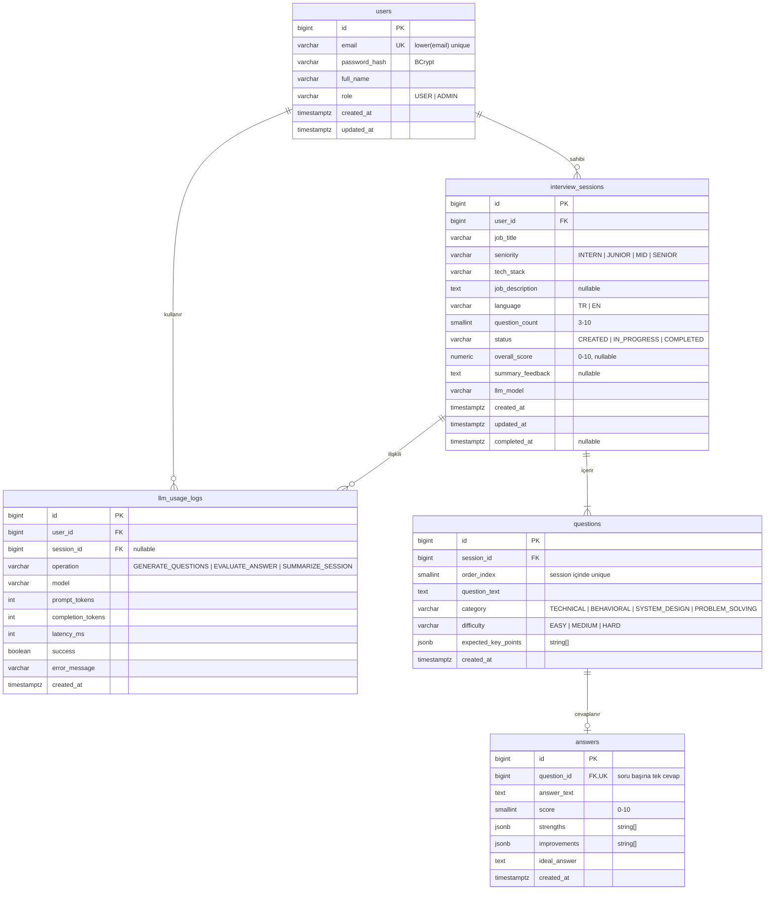

# 3. Veritabanı

PostgreSQL 16+ (lokalde Docker, canlıda Neon). Şemayı **sadece Flyway** yönetir; Hibernate `ddl-auto: validate` modunda çalışır.
Referans şema: [`docs/sql/V1__init_schema.sql`](sql/V1__init_schema.sql). Önce migration'ı bu dokümana bakarak kendin yaz, sonra referansla karşılaştır. Dosya `backend/src/main/resources/db/migration/` altına gider.

## ER Diyagramı

> Diyagram [Mermaid](https://mermaid.js.org/) ile yazıldı; GitHub ve çoğu Markdown görüntüleyici doğrudan çizer. README'ye PNG koymak istersen <https://mermaid.live> üzerinden dışa aktar.

## İlişkiler

| İlişki | Tür | Silme davranışı | Açıklama |
|---|---|---|---|
| `users` → `interview_sessions` | 1 – N | `CASCADE` | Kullanıcının birden çok mülakatı olur |
| `interview_sessions` → `questions` | 1 – N (en az 3) | `CASCADE` | Mülakat oluşurken sorular aynı transaction'da yazılır |
| `questions` → `answers` | 1 – 0..1 | `CASCADE` | `answers.question_id` UNIQUE olduğu için soru başına tek cevap |
| `users` → `llm_usage_logs` | 1 – N | `CASCADE` | Kota ve istatistik için her LLM çağrısı |
| `interview_sessions` → `llm_usage_logs` | 1 – N | `SET NULL` | Mülakat silinse de kullanım kaydı kalır (kota atlatılamasın) |

## Tablolar ve Tasarım Kararları

### `users`
- E-posta benzersizliği `LOWER(email)` üzerinde fonksiyonel indeksle sağlanır (`Ali@x.com` ve `ali@x.com` aynı kişi). Servis katmanında da kaydetmeden önce e-postayı küçük harfe çevir.
- `role` enum'u DB'de `VARCHAR` + `CHECK` olarak tutulur; JPA'da `EnumType.STRING`. PostgreSQL native enum yerine bu tercih edildi çünkü yeni değer eklemek migration'da daha kolay.

### `interview_sessions`
- Kullanıcının mülakat oturumu. `overall_score` ve `summary_feedback` oturum tamamlanınca dolar.
- `llm_model` hangi modelle üretildiğini saklar (model değiştirince eski sonuçları kıyaslayabilmek için).
- `ix_sessions_user_created` indeksi "geçmişim" listesini (`user_id` filtresi + `created_at` azalan sıralama) hızlandırır.

### `questions`
- `(session_id, order_index)` benzersiz — sıralama garanti.
- `expected_key_points` LLM'in soruyu üretirken belirlediği "iyi bir cevapta olması gerekenler". Değerlendirme prompt'unda kullanılır, **cevap verilmeden frontend'e gönderilmez** (kopya olmasın).

### `answers`
- `question_id` üzerinde `UNIQUE` → her soruya tek cevap (aynı soruyu iki kez değerlendirtip kota harcamayı engeller; tekrar gönderimde `409`).
- `strengths` / `improvements` string dizisi olarak `JSONB`.

### `llm_usage_logs`
- Her LLM çağrısı (başarılı ya da başarısız) loglanır → günlük kota, gecikme ve token istatistikleri.
- Kota kontrolü: kullanıcının bugün (UTC 00:00'dan beri) kaç kaydı var? → `ix_usage_user_created` indeksini kullanır.

## İndeksler

| İndeks | Kolonlar | Hangi sorgu için |
|---|---|---|
| `ux_users_email_lower` | `LOWER(email)` UNIQUE | Login ve kayıt kontrolü |
| `ix_sessions_user_created` | `(user_id, created_at DESC)` | Geçmiş mülakatlar listesi |
| `ux_questions_session_order` | `(session_id, order_index)` UNIQUE | Soru sırası |
| `ux_answers_question` | `(question_id)` UNIQUE | Tek cevap kuralı + join |
| `ix_usage_user_created` | `(user_id, created_at)` | Günlük kota sayımı |

## JPA Eşleme Rehberi

| Tablo | Entity | Dikkat edilecekler |
|---|---|---|
| ortak kolonlar | `BaseEntity` (`@MappedSuperclass`) | `id` → `GenerationType.IDENTITY` (şemada `GENERATED ALWAYS AS IDENTITY`), `createdAt` → `@CreationTimestamp`, `updatable = false` |
| `users` | `User` | `role` → `@Enumerated(EnumType.STRING)`. Şifre hash'ini hiçbir DTO'ya koyma |
| `interview_sessions` | `InterviewSession` | `user` → `@ManyToOne(fetch = LAZY)`. `questions` → `@OneToMany(mappedBy = "session", cascade = ALL, orphanRemoval = true)` + `@OrderBy("orderIndex")`. İlişkiyi iki taraflı kuran bir `addQuestion()` yardımcı metodu ekle |
| `questions` | `Question` | `expectedKeyPoints` bir `List<String>`; Hibernate 6+ `@JdbcTypeCode(SqlTypes.JSON)` ile JSONB'ye ek kütüphane olmadan eşlenir. `answer` → `@OneToOne(mappedBy = "question")` |
| `answers` | `Answer` | `question` → `@OneToOne(fetch = LAZY)` + `@JoinColumn(name = "question_id", unique = true)`. `strengths`, `improvements` aynı JSONB yöntemiyle |
| `llm_usage_logs` | `LlmUsageLog` | İlişki kurmak yerine `userId` / `sessionId` düz `Long` kolon olarak tutulabilir; sadece yazılıp sayıldığı için yeterli |

Enum'lar: `Role`, `Seniority`, `InterviewLanguage`, `SessionStatus`, `QuestionCategory`, `Difficulty`, `LlmOperation`. Değerleri `CHECK` kısıtlarıyla birebir aynı olmalı; aksi halde kayıt sırasında DB hatası alırsın.

**N+1 problemine dikkat:** Mülakat detay ekranı oturum + sorular + cevapları birlikte ister. Bunu tek sorguda çekmek için repository'de `left join fetch` kullanan bir JPQL sorgusu yaz (ör. `findDetailByIdAndUserId`). Sorguda `user.id` filtresini de kullan; böylece sahiplik kontrolü de aynı sorguda yapılır. Test ederken `spring.jpa.show-sql=true` ile kaç sorgu atıldığına bak.

## Panel İstatistik Sorguları

`GET /api/stats/me` üç sorguyla beslenir. Hepsi `user_id` ile filtrelenir:

| Sorgu | Tablolar | Mantık |
|---|---|---|
| Genel özet | `interview_sessions` | Toplam oturum sayısı, `status = 'COMPLETED'` olanların sayısı (`count(*) FILTER (WHERE ...)`), `overall_score` ortalaması |
| Kategori bazlı ortalama | `answers` ⨝ `questions` ⨝ `interview_sessions` | `questions.category`'ye göre grupla, `answers.score` ortalaması ve cevap sayısı |
| Puan trendi | `interview_sessions` | Tamamlanmış son 10 oturum, `completed_at` azalan sırada |

Bunları Spring Data'da native query + interface projection ile ya da JPQL ile yazabilirsin. Native SQL ile `FILTER` gibi PostgreSQL özelliklerini kullanmak mülakatta anlatılabilecek bir detay.

## Seed Verisi

Test kullanıcısını elle eklemek yerine `POST /api/auth/register` kullan. Seed gerekirse sadece `local` profilinde çalışan ayrı bir Flyway lokasyonu (`db/seed`) kullan; canlıya seed gönderme.

## Şema Değişiklikleri

Şemayı değiştirmek için **uygulanmış bir migration'ı asla düzenleme** (Flyway checksum hatası verir). Yeni dosya ekle: `V2__add_followup_question.sql` gibi. Örneğin bonus "takip sorusu" özelliği için `questions` tablosuna kendine referans veren, `nullable` bir `parent_question_id` kolonu eklemek yeterli.
