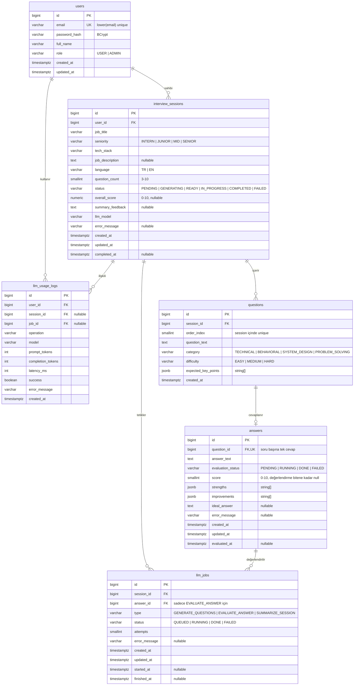

# 3. Veritabanı

PostgreSQL 16+ (lokalde Docker). Şemayı **sadece Flyway** yönetir; Hibernate `ddl-auto: validate` modunda çalışır.
Referans şema: [`docs/sql/V1__init_schema.sql`](sql/V1__init_schema.sql). Önce migration'ı bu dokümana bakarak kendin yaz, sonra referansla karşılaştır. Dosya `src/main/resources/db/migration/` altına gider.

Şema baştan **asenkron akışa göre** tasarlandı: bir cevap, değerlendirmesi gelmeden önce kaydedilir; bir oturum, soruları üretilmeden önce var olur. Bu yüzden bazı kolonlar nullable ve iki ayrı durum alanı (`interview_sessions.status`, `answers.evaluation_status`) var.

## ER Diyagramı



> Diyagram [Mermaid](https://mermaid.js.org/) ile yazıldı; GitHub ve çoğu Markdown görüntüleyici doğrudan çizer. README'ye PNG koymak istersen <https://mermaid.live> üzerinden dışa aktar.

## İlişkiler

| İlişki | Tür | Silme davranışı | Açıklama |
|---|---|---|---|
| `users` → `interview_sessions` | 1 – N | `CASCADE` | Kullanıcının birden çok mülakatı olur |
| `interview_sessions` → `questions` | 1 – N (0 olabilir) | `CASCADE` | Sorular oturumdan **sonra**, tüketici tarafından yazılır |
| `questions` → `answers` | 1 – 0..1 | `CASCADE` | `answers.question_id` UNIQUE olduğu için soru başına tek cevap |
| `interview_sessions` → `llm_jobs` | 1 – N | `CASCADE` | Her LLM işinin izi; oturum silinince işler de gider |
| `answers` → `llm_jobs` | 1 – N | `CASCADE` | Değerlendirme işi ve varsa tekrar denemeleri |
| `users` → `llm_usage_logs` | 1 – N | `CASCADE` | Kota ve istatistik için her LLM çağrısı |
| `interview_sessions` → `llm_usage_logs` | 1 – N | `SET NULL` | Mülakat silinse de kullanım kaydı kalır (kota atlatılamasın) |

> Dikkat: `questions` artık `1 – 1..N` değil `1 – 0..N`. Oturum `PENDING` durumundayken hiç sorusu yoktur. Eski tasarımdaki "en az 3 soru" garantisi artık DB'de değil, iş kuralında.

## Tablolar ve Tasarım Kararları

### `users`
- E-posta benzersizliği `LOWER(email)` üzerinde fonksiyonel indeksle sağlanır (`Ali@x.com` ve `ali@x.com` aynı kişi). Servis katmanında da kaydetmeden önce e-postayı küçük harfe çevir.
- `role` enum'u DB'de `VARCHAR` + `CHECK` olarak tutulur; JPA'da `EnumType.STRING`. PostgreSQL native enum yerine bu tercih edildi çünkü yeni değer eklemek migration'da daha kolay.

### `interview_sessions`
- `status` altı değerli bir durum makinesi ([Mimari → Oturum durum makinesi](02-mimari.md#oturum-durum-makinesi)). Varsayılan `PENDING`: kayıt atıldığında sorular henüz yok.
- `error_message` LLM işi kalıcı olarak başarısız olduğunda kullanıcıya gösterilecek metni tutar (stack trace değil, anlaşılır bir cümle).
- `overall_score` ve `summary_feedback` oturum tamamlanınca dolar.
- `llm_model` hangi modelle üretildiğini saklar. Ollama'da model değiştirmek çok kolay olduğu için bu kolon burada Groq'a göre daha değerli: `llama3.2:3b` ile `qwen2.5:7b` sonuçlarını kıyaslayabilirsin.
- `ix_sessions_user_created` indeksi "geçmişim" listesini (`user_id` filtresi + `created_at` azalan sıralama) hızlandırır.

### `questions`
- `(session_id, order_index)` benzersiz — sıralama garanti.
- `expected_key_points` LLM'in soruyu üretirken belirlediği "iyi bir cevapta olması gerekenler". Değerlendirme prompt'unda kullanılır, **cevap verilmeden frontend'e gönderilmez** (kopya olmasın).

### `answers`
- `question_id` üzerinde `UNIQUE` → her soruya tek cevap (tekrar gönderimde `409`).
- `evaluation_status` cevabın değerlendirmesinin nerede olduğunu söyler. Cevap `PENDING` ile kaydedilir, tüketici `RUNNING` yapar, sonuç yazılınca `DONE` olur.
- `score` ve `ideal_answer` **nullable**, çünkü değerlendirme gelmeden önce cevap zaten kayıtlı. `chk_answers_done_fields` kısıtı "DONE ise bu alanlar dolu olmalı" kuralını veritabanı seviyesinde garanti eder — uygulamadaki bir hata yüzünden yarım kayıt oluşmasını engeller.
- `strengths` / `improvements` string dizisi olarak `JSONB`, varsayılan boş dizi.

### `llm_jobs`
- Kuyruğa atılan her işin kalıcı izi. RabbitMQ mesajı uçucudur; bu tablo "ne oldu?" sorusunun cevabını verir.
- `attempts` her denemede artar. `status = FAILED` ve `attempts = 3` olan kayıtlar DLQ'daki mesajlara karşılık gelir.
- `chk_jobs_answer` kısıtı `EVALUATE_ANSWER` işinin mutlaka bir cevaba, diğer iş tiplerinin ise hiçbir cevaba bağlı olmamasını zorlar. Bu tür "koşullu zorunluluk" kısıtları mülakatta anlatılabilecek güzel bir detay.
- `ix_jobs_status_created` indeksi iki işe yarar: admin ekranında bekleyen işleri listelemek ve "uzun süredir `RUNNING` kalmış işler" (uygulama çökmüşse) sorgusu.
- **Idempotency anahtarı burası:** tüketici mesajı alınca önce `llm_jobs` kaydına bakar, `DONE` ise hiçbir şey yapmaz. RabbitMQ aynı mesajı iki kez teslim edebilir.

### `llm_usage_logs`
- Her LLM çağrısı (başarılı ya da başarısız) loglanır → günlük kota, gecikme ve token istatistikleri.
- `job_id` ile hangi kuyruk işine ait olduğu izlenir; bir iş 3 kez denendiyse 3 log satırı oluşur.
- Ollama `ChatResponse` metadata'sında `promptTokens` ve `generationTokens` döner (Ollama'nın `prompt_eval_count` / `eval_count` alanları). Parasal maliyet yok ama **gecikme analizi** için çok değerli: hangi model, kaç token, kaç ms.
- Kota kontrolü: kullanıcının bugün (UTC 00:00'dan beri) kaç kaydı var? → `ix_usage_user_created` indeksini kullanır.

## İndeksler

| İndeks | Kolonlar | Hangi sorgu için |
|---|---|---|
| `ux_users_email_lower` | `LOWER(email)` UNIQUE | Login ve kayıt kontrolü |
| `ix_sessions_user_created` | `(user_id, created_at DESC)` | Geçmiş mülakatlar listesi |
| `ux_questions_session_order` | `(session_id, order_index)` UNIQUE | Soru sırası |
| `ux_answers_question` | `(question_id)` UNIQUE | Tek cevap kuralı + join |
| `ix_jobs_session` | `(session_id)` | Oturumun işlerini getirme |
| `ix_jobs_status_created` | `(status, created_at)` | Bekleyen / takılı kalmış işler |
| `ix_usage_user_created` | `(user_id, created_at)` | Günlük kota sayımı |

## JPA Eşleme Rehberi

| Tablo | Entity | Dikkat edilecekler |
|---|---|---|
| ortak kolonlar | `BaseEntity` (`@MappedSuperclass`) | `id` → `GenerationType.IDENTITY` (şemada `GENERATED ALWAYS AS IDENTITY`), `createdAt` → `@CreationTimestamp`, `updatable = false`, `updatedAt` → `@UpdateTimestamp` |
| `users` | `User` | `role` → `@Enumerated(EnumType.STRING)`. Şifre hash'ini hiçbir DTO'ya koyma |
| `interview_sessions` | `InterviewSession` | `user` → `@ManyToOne(fetch = LAZY)`. `questions` → `@OneToMany(mappedBy = "session", cascade = ALL, orphanRemoval = true)` + `@OrderBy("orderIndex")`. İlişkiyi iki taraflı kuran bir `addQuestion()` yardımcı metodu ekle |
| `questions` | `Question` | `expectedKeyPoints` bir `List<String>`; Hibernate 6+ `@JdbcTypeCode(SqlTypes.JSON)` ile JSONB'ye ek kütüphane olmadan eşlenir. `answer` → `@OneToOne(mappedBy = "question")` |
| `answers` | `Answer` | `question` → `@OneToOne(fetch = LAZY)` + `@JoinColumn(name = "question_id", unique = true)`. `score` alanı `Integer` (primitive `int` değil — null olabilir). `strengths`, `improvements` aynı JSONB yöntemiyle |
| `llm_jobs` | `LlmJob` | `session` → `@ManyToOne(fetch = LAZY)`, `answerId` düz `Long` olarak tutulabilir. Tüketicide durum güncellemesi kısa ve ayrı bir `@Transactional` metotta yapılmalı |
| `llm_usage_logs` | `LlmUsageLog` | İlişki kurmak yerine `userId` / `sessionId` / `jobId` düz `Long` kolon olarak tutulabilir; sadece yazılıp sayıldığı için yeterli |

Enum'lar: `Role`, `Seniority`, `InterviewLanguage`, `SessionStatus`, `EvaluationStatus`, `QuestionCategory`, `Difficulty`, `LlmJobType`, `LlmJobStatus`, `LlmOperation`. Değerleri `CHECK` kısıtlarıyla birebir aynı olmalı; aksi halde kayıt sırasında DB hatası alırsın.

**N+1 problemine dikkat:** Mülakat detay ekranı oturum + sorular + cevapları birlikte ister. Bunu tek sorguda çekmek için repository'de `left join fetch` kullanan bir JPQL sorgusu yaz (ör. `findDetailByIdAndUserId`). Sorguda `user.id` filtresini de kullan; böylece sahiplik kontrolü de aynı sorguda yapılır. Polling yüzünden bu sorgu 2 saniyede bir çalışacak, verimli olması normalden daha önemli. Test ederken `spring.jpa.show-sql=true` ile kaç sorgu atıldığına bak.

**Tüketicide transaction sınırı:** `LlmJobListener` içinde tüm metodu `@Transactional` yapma. 60 saniyelik LLM çağrısı boyunca DB bağlantısı açık kalır ve havuz tükenir. Doğrusu: kısa transaction (durumu `RUNNING` yap) → transaction dışında LLM çağrısı → kısa transaction (sonucu yaz).

## Panel İstatistik Sorguları

`GET /api/stats/me` üç sorguyla beslenir. Hepsi `user_id` ile filtrelenir:

| Sorgu | Tablolar | Mantık |
|---|---|---|
| Genel özet | `interview_sessions` | Toplam oturum sayısı, `status = 'COMPLETED'` olanların sayısı (`count(*) FILTER (WHERE ...)`), `overall_score` ortalaması |
| Kategori bazlı ortalama | `answers` ⨝ `questions` ⨝ `interview_sessions` | `questions.category`'ye göre grupla, `answers.score` ortalaması ve cevap sayısı. **`WHERE answers.evaluation_status = 'DONE'`** filtresini unutma, yoksa değerlendirilmemiş cevaplar ortalamayı bozar |
| Puan trendi | `interview_sessions` | Tamamlanmış son 10 oturum, `completed_at` azalan sırada |

Bunları Spring Data'da native query + interface projection ile ya da JPQL ile yazabilirsin. Native SQL ile `FILTER` gibi PostgreSQL özelliklerini kullanmak mülakatta anlatılabilecek bir detay.

## İşe Yarayan Bakım Sorguları

Geliştirirken sık kullanacakların:

```sql
-- Takılı kalmış işler (uygulama çöktüyse RUNNING'de kalırlar)
SELECT * FROM llm_jobs
WHERE status = 'RUNNING' AND started_at < now() - INTERVAL '5 minutes';

-- Başarısız işler ve sebepleri
SELECT type, error_message, count(*) FROM llm_jobs
WHERE status = 'FAILED' GROUP BY type, error_message ORDER BY count(*) DESC;

-- Model bazında ortalama gecikme
SELECT model, operation, avg(latency_ms)::int AS avg_ms, count(*) FROM llm_usage_logs
WHERE success GROUP BY model, operation;
```

Sonuncusu model seçerken işine yarar: `llama3.2:3b` ile `qwen2.5:7b` arasındaki hız farkını ölçüp README'ye yazabilirsin.

## Seed Verisi

Test kullanıcısını elle eklemek yerine `POST /api/auth/register` kullan. Seed gerekirse sadece `local` profilinde çalışan ayrı bir Flyway lokasyonu (`db/seed`) kullan.

## Şema Değişiklikleri

Şemayı değiştirmek için **uygulanmış bir migration'ı asla düzenleme** (Flyway checksum hatası verir). Yeni dosya ekle: `V2__add_followup_question.sql` gibi. Örneğin bonus "takip sorusu" özelliği için `questions` tablosuna kendine referans veren, `nullable` bir `parent_question_id` kolonu eklemek yeterli.

`V1` henüz hiçbir ortamda çalışmadıysa (ki şu an öyle) onu düzenlemek serbest — asenkron yapıyı baştan koymamızın sebebi de bu.
