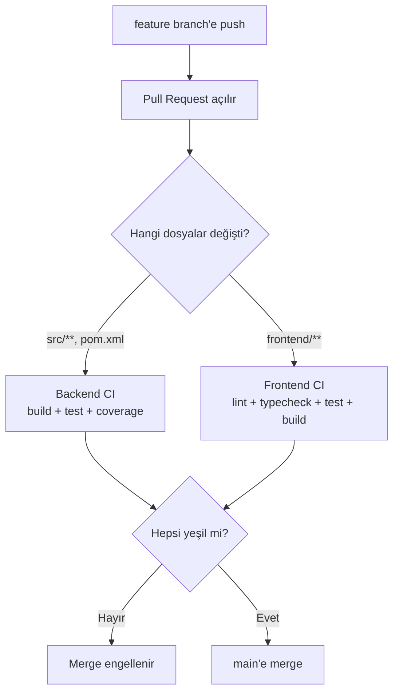

# 6. CI

Araç: **GitHub Actions** (public repoda ücretsiz ve sınırsız dakika).

Bu projenin canlı ortamı yok ([Proje Fikri → Kapsam Dışı](01-proje-fikri.md#kapsam-dışı-bilerek-yapmıyoruz)), dolayısıyla **CD yok, sadece CI var**. Bu CI'yi önemsizleştirmez — tam tersine: canlı link olmadığı için projenin gerçekten çalıştığının tek dış kanıtı yeşil pipeline ve içindeki entegrasyon testleridir. İşe alımcı Actions sekmesine bakıp "her commit'te gerçek pgvector ve RabbitMQ ile uçtan uca test koşuyor" görebilmeli.

## Hedef

- Her PR'da backend ve frontend testleri otomatik koşsun, kırmızıysa merge edilemesin.
- Testler **Ollama olmadan** koşsun: CI'da `AI_PROVIDER=mock`.
- Testcontainers ile gerçek **pgvector** ve **RabbitMQ** ayağa kalksın.

## Pipeline Akışı



## Branch Stratejisi (GitHub Flow)

- `main` her zaman çalışır durumda; doğrudan push yok.
- Kısa ömürlü branch'ler: `feat/document-upload`, `fix/vector-search-filter`, `chore/ci`.
- Commit mesajları [Conventional Commits](https://www.conventionalcommits.org/): `feat: add document upload endpoint`, `fix: filter chunks by user in vector search`, `test: add chunking service tests`.
- GitHub → Settings → Branches → `main` için **ruleset**:
  - Require a pull request before merging
  - Require status checks to pass → `backend-test`, `frontend-test`
  - Block force pushes

Tek başına çalışıyorsan bile PR aç: repo geçmişinde düzgün PR'lar işe alımcılar için iyi bir sinyal.

## Workflow 1: Backend (`.github/workflows/backend.yml`)

**Tetikleyiciler:** `pull_request` ve `push` (`main`), sadece `src/**`, `pom.xml`, `mvnw*`, `.mvn/**` veya bu workflow dosyası değişince. Elle çalıştırmak için `workflow_dispatch`.

> `paths` filtresi yüzünden `docs/` veya `.gitignore` değiştiğinde CI **koşmaz**. Bilerek böyle; Actions'ta run görmüyorsan önce hangi dosyaların değiştiğine bak.

**Genel ayarlar:** Aynı branch'te yeni push gelince eskisini iptal etmek için `concurrency` grubu (`cancel-in-progress: true`).

### Job `backend-test`

| # | Adım | Nasıl | Not |
|---|---|---|---|
| 1 | Kodu çek | `actions/checkout` | |
| 2 | Java 21 kur | `actions/setup-java` → `temurin`, `21`, `cache: maven` | Maven cache build'i dakikalarca hızlandırır |
| 3 | Test + paketle | `./mvnw -B verify` | `-B` batch mod |
| 4 | Ortam değişkenleri | `AI_PROVIDER=mock`, `JWT_SECRET=<32+ karakter>` | **CI'da Ollama yok**; mock olmadan testler koşmaz |
| 5 | Test raporu | `actions/upload-artifact` ile `target/surefire-reports`, `target/site/jacoco` | Başarısız testte indirip bakabilirsin |

```yaml
env:
  AI_PROVIDER: mock
  JWT_SECRET: ci-test-jwt-secret-minimum-32-characters-long
```

### Testcontainers notları

- `ubuntu-latest` runner'ında Docker kurulu gelir; ek ayar gerekmez.
- **pgvector imajı** gerekiyor. Testler `pgvector/pgvector:pg16` çeker; ilk çalıştırmada birkaç saniye indirme olur:

```java
@Container
@ServiceConnection
static PostgreSQLContainer<?> postgres =
    new PostgreSQLContainer<>(DockerImageName.parse("pgvector/pgvector:pg16")
        .asCompatibleSubstituteFor("postgres"));
```

`asCompatibleSubstituteFor("postgres")` olmadan Testcontainers imajı tanımaz ve hata verir.

- RabbitMQ konteyneri PostgreSQL'e göre yavaş açılır (~10 sn). Asenkron testlerde Awaitility kullan, sabit `sleep` koyma.
- `CREATE EXTENSION vector` migration içinde olduğu için Testcontainers'ın varsayılan superuser'ı bunu çalıştırabilir. Kısıtlı bir kullanıcı tanımlarsan eklenti oluşturma yetkisi verilmeli.
- Coverage için `jacoco-maven-plugin`; `verify` fazında rapor üretsin. İstersen minimum %60 satır kuralı (`check` goal).

### Neden Docker imajı build edilmiyor?

Deploy edilecek bir yer olmadığı için `backend-docker` / `backend-deploy` job'ları yok. Yine de bir `Dockerfile` bulundurmak isteyebilirsin ([aşağıda](#dockerfile-opsiyonel)); o durumda push etmeden sadece build kontrolü ekleyebilirsin:

```yaml
- name: Docker build (smoke)
  run: docker build -t documind-backend:ci .
```

Maliyeti ~1 dakika, faydası: ileride deploy etmeye karar verirsen imajın bozulmadığını garanti eder.

## Workflow 2: Frontend (`.github/workflows/frontend.yml`)

**Tetikleyiciler:** `pull_request` ve `push` (`main`), sadece `frontend/**`.

| # | Adım | Komut |
|---|---|---|
| 1 | Checkout | `actions/checkout` |
| 2 | Node 22 | `actions/setup-node` → `cache: npm`, `cache-dependency-path: frontend/package-lock.json` |
| 3 | Bağımlılıklar | `npm ci` (lock'a birebir uyar, `npm install` değil) |
| 4 | Lint | `npm run lint` |
| 5 | Tip kontrolü | `npx tsc -b` |
| 6 | Test | `npx vitest run` |
| 7 | Build | `npm run build` (`VITE_API_URL=http://localhost:8087` yeterli) |

## Secret'lar

Bu projede GitHub secret'ına **gerek yok**. Deploy hook, LLM API anahtarı, veritabanı şifresi — hiçbiri CI'da kullanılmıyor. `JWT_SECRET` workflow içinde düz `env:` olarak verilir çünkü sadece test amaçlı.

Anahtar gerektirmeyen bir yığın seçmenin yan faydası bu: sızdırılacak bir sır yok.

`GITHUB_TOKEN` otomatik gelir.

## Dockerfile (opsiyonel)

Deploy etmesen de bulundurmak "bu proje konteynerleştirilebilir" sinyali verir.

| Aşama | Base image | İş |
|---|---|---|
| 1. build | `eclipse-temurin:21-jdk` | `pom.xml` + `.mvn` kopyala → `./mvnw dependency:go-offline` → `src` kopyala → `./mvnw -DskipTests package` |
| 2. run | `eclipse-temurin:21-jre` | Sadece jar'ı kopyala, root olmayan kullanıcı, `EXPOSE 8087` |

Notlar:
- Uygulama `PORT` değişkenini dinlemeli (`server.port: ${PORT:8087}`).
- Testler CI'da koştuğu için build içinde `-DskipTests`.
- `.dockerignore`: `target/`, `.idea/`, `*.iml`, `.env`, `docs/`, `data/`.
- Konteynerden Ollama'ya erişmek için `OLLAMA_BASE_URL=http://host.docker.internal:11434`; `localhost` konteynerin kendisidir.
- **Yüklenen dosyalar için volume gerekir.** `app.storage.path` konteyner içinde kalıcı olmayan bir dizine bakarsa yeniden başlatmada dokümanlar kaybolur, DB kayıtları ise kalır. `-v documind_data:/app/data` ile bağla.

## Ekstralar (zaman kalırsa)

| Ekstra | Ne işe yarar | Maliyet |
|---|---|---|
| README badge'leri | Actions durum rozeti — canlı link olmadığı için en görünür "çalışıyor" işareti | 2 dk |
| Dependabot (`.github/dependabot.yml`) | Maven, npm, Actions için haftalık güncelleme PR'ları | 5 dk |
| CodeQL | Ücretsiz güvenlik taraması (Java + TypeScript) | 5 dk |
| PR şablonu | `.github/pull_request_template.md` | 5 dk |
| Release | Proje bitince `v1.0.0` tag'i + Release notları | 10 dk |

## Sık Karşılaşılan CI Hataları

| Hata | Sebep | Çözüm |
|---|---|---|
| Actions'ta hiç run yok | `paths` filtresi dışındaki dosyalar değişti (`docs/`, `.gitignore`) | Normal; elle: Actions → Run workflow |
| `./mvnw: Permission denied` | Wrapper çalıştırma izni git'e kaydedilmemiş | `git update-index --chmod=+x mvnw` |
| `release version 21 not supported` | Runner'da (ya da lokalde) Java 21 yok | `setup-java` adımını kontrol et; lokalde `JAVA_HOME` |
| `extension "vector" is not available` | Testcontainers standart `postgres` imajı kullanıyor | `pgvector/pgvector:pg16` + `asCompatibleSubstituteFor("postgres")` |
| `Can't load IANA registry` / imaj tanınmıyor | `asCompatibleSubstituteFor` eksik | Yukarıdaki kalıbı kullan |
| Testcontainers "Could not find a valid Docker environment" | Docker'sız runner | `ubuntu-latest` kullan |
| RabbitMQ testleri zaman aşımına uğruyor | Konteyner hazır değil | `@ServiceConnection` + Awaitility; sabit `sleep` koyma |
| `JWT_SECRET` yok hatası | Test profili değişkeni bulamıyor | Workflow'da `env:` veya `src/test/resources/application.properties` |
| Testler CI'da dakikalarca sürüyor | `AI_PROVIDER` mock değil | Workflow `env:` bloğunu kontrol et |
| Vektör testi lokalde geçiyor CI'da düşüyor | Mock embedding deterministik değil | Mock, metnin hash'inden sabit vektör üretmeli |
| `npm ci` lock hatası | `package-lock.json` güncel değil | Lokalde `npm install` → lock'u commit'le |
