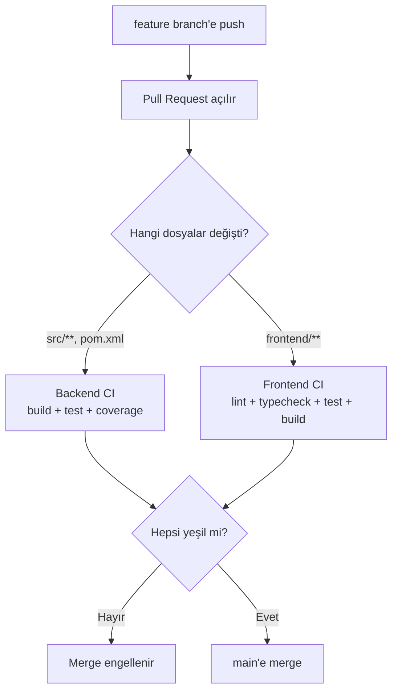

# 6. CI

Araç: **GitHub Actions** (public repoda ücretsiz ve sınırsız dakika).

Bu projenin canlı ortamı yok ([Proje Fikri → Kapsam Dışı](01-proje-fikri.md#kapsam-dışı-bilerek-yapmıyoruz)), dolayısıyla **CD yok, sadece CI var**. Bu, CI'yi önemsizleştirmez — tam tersine: canlı link olmadığı için projenin gerçekten çalıştığının tek dış kanıtı yeşil pipeline ve içindeki entegrasyon testleridir. İşe alımcı Actions sekmesine bakıp "her commit'te gerçek PostgreSQL ve RabbitMQ ile uçtan uca test koşuyor" görebilmeli.

## Hedef

- Her PR'da backend ve frontend testleri otomatik koşsun, kırmızıysa merge edilemesin.
- Testler **Ollama olmadan** koşsun: CI'da `LLM_PROVIDER=mock`.
- Testcontainers ile gerçek PostgreSQL ve RabbitMQ ayağa kalksın.

## Pipeline Akışı



## Branch Stratejisi (GitHub Flow)

- `main` her zaman çalışır durumda; doğrudan push yok.
- Her iş için kısa ömürlü branch: `feat/interview-create`, `fix/jwt-expiry`, `chore/ci`.
- Commit mesajları [Conventional Commits](https://www.conventionalcommits.org/) formatında: `feat: add answer evaluation endpoint`, `fix: clamp llm score`, `test: add quota service tests`, `ci: add backend workflow`.
- GitHub → Settings → Branches → `main` için **branch protection / ruleset**:
  - Require a pull request before merging
  - Require status checks to pass → `backend-test`, `frontend-test` job'larını seç
  - Block force pushes

Tek başına çalışıyorsan bile PR aç: repo geçmişinde düzgün PR'lar görmek işe alımcılar için iyi bir sinyal.

## Workflow 1: Backend (`.github/workflows/backend.yml`)

**Tetikleyiciler:** `pull_request` ve `push` (`main`), sadece `src/**`, `pom.xml`, `mvnw*`, `.mvn/**` veya bu workflow dosyası değişince (`paths` filtresi). Elle çalıştırmak için `workflow_dispatch` de ekle.

> `paths` filtresi yüzünden `docs/` veya `.gitignore` değiştiğinde CI **koşmaz**. Bu bilerek böyle; Actions sekmesinde run görmüyorsan önce hangi dosyaların değiştiğine bak.

**Genel ayarlar:** Aynı branch'te yeni push gelince eski çalışmayı iptal etmek için `concurrency` grubu (`cancel-in-progress: true`).

### Job `backend-test` (her PR ve push)

| # | Adım | Nasıl | Not |
|---|---|---|---|
| 1 | Kodu çek | `actions/checkout` | |
| 2 | Java 21 kur | `actions/setup-java` → `distribution: temurin`, `java-version: 21`, `cache: maven` | Maven cache build'i dakikalarca hızlandırır |
| 3 | Test + paketle | `./mvnw -B verify` | `-B` batch mod, log kirliliğini azaltır |
| 4 | Ortam değişkenleri | `LLM_PROVIDER=mock`, `JWT_SECRET=` test için rastgele 32+ karakter | **CI'da Ollama yok**; mock olmadan testler koşmaz |
| 5 | Test raporu | `actions/upload-artifact` ile `target/surefire-reports` ve `target/site/jacoco` | Başarısız testte raporu indirip bakabilirsin |

- **Testcontainers** GitHub'ın `ubuntu-latest` runner'ında ek ayar olmadan çalışır (Docker kurulu gelir). PostgreSQL ve RabbitMQ konteynerlerini testler kendisi ayağa kaldırır; `services:` bloğu tanımlamana gerek yok.
- RabbitMQ konteyneri PostgreSQL'e göre biraz yavaş açılır (~10 sn). Entegrasyon testlerinde Awaitility ile bekle, sabit `sleep` koyma.
- Coverage için `jacoco-maven-plugin` ekle; `verify` fazında rapor üretsin. İstersen minimum %60 satır kapsamı kuralı koy (`check` goal).

### Neden Docker imajı build edilmiyor?

Deploy edilecek bir yer olmadığı için `backend-docker` ve `backend-deploy` job'ları kaldırıldı. Yine de bir `Dockerfile` bulundurmak isteyebilirsin ([aşağıda](#dockerfile-opsiyonel)); o durumda CI'ya sadece "imaj build oluyor mu?" kontrolü ekleyebilirsin — push etmeden:

```yaml
- name: Docker build (smoke)
  run: docker build -t interviewpilot-backend:ci .
```

Bu, ileride deploy etmeye karar verirsen imajın bozulmadığını garanti eder. Maliyeti ~1 dakika.

## Workflow 2: Frontend (`.github/workflows/frontend.yml`)

**Tetikleyiciler:** `pull_request` ve `push` (`main`), sadece `frontend/**` değişince.

### Job `frontend-test`

| # | Adım | Komut |
|---|---|---|
| 1 | Checkout | `actions/checkout` |
| 2 | Node 22 kur | `actions/setup-node` → `node-version: 22`, `cache: npm`, `cache-dependency-path: frontend/package-lock.json` |
| 3 | Bağımlılıklar | `npm ci` (lock dosyasına birebir uyar, `npm install` değil) |
| 4 | Lint | `npm run lint` |
| 5 | Tip kontrolü | `npx tsc -b` (veya `npm run typecheck`) |
| 6 | Test | `npx vitest run` |
| 7 | Build | `npm run build` (`VITE_API_URL` build'de gerekli, CI için `http://localhost:8087` yeterli) |

## Secret'lar

Bu projede GitHub secret'ına **gerek yok**. Deploy hook, Vercel token, veritabanı şifresi, LLM API anahtarı — hiçbiri CI'da kullanılmıyor. `JWT_SECRET` workflow içinde düz `env:` olarak verilir çünkü sadece test amaçlıdır.

Anahtar gerektirmeyen bir yığın seçmenin yan faydası bu: sızdırılacak bir sır yok.

`GITHUB_TOKEN` otomatik gelir, eklemene gerek yok.

## Dockerfile (opsiyonel)

Deploy etmesen de bir `Dockerfile` bulundurmak, "bu proje konteynerleştirilebilir" sinyali verir ve ileride Groq'a geçip deploy etmek istersen hazır olur.

Multi-stage build kullan:

| Aşama | Base image | İş |
|---|---|---|
| 1. build | `eclipse-temurin:21-jdk` | `pom.xml` + `.mvn` kopyala → `./mvnw dependency:go-offline` (bağımlılık katmanı cache'lensin) → `src` kopyala → `./mvnw -DskipTests package` |
| 2. run | `eclipse-temurin:21-jre` | Sadece jar'ı kopyala, root olmayan kullanıcıyla çalıştır, `EXPOSE 8087` |

Notlar:
- Uygulama `PORT` ortam değişkenini dinlemeli (`server.port: ${PORT:8087}`).
- Testler CI'da koştuğu için Docker build içinde `-DskipTests` kullan.
- `.dockerignore`: `target/`, `.idea/`, `*.iml`, `.env`, `docs/`.
- Konteynerden Ollama'ya erişmek için `OLLAMA_BASE_URL=http://host.docker.internal:11434` vermen gerekir; `localhost` konteynerin kendisini işaret eder.

## Ekstralar (zaman kalırsa)

| Ekstra | Ne işe yarar | Maliyet |
|---|---|---|
| README badge'leri | Actions durum rozeti (`backend`, `frontend`) — canlı link olmadığı için en görünür "çalışıyor" işareti | 2 dk |
| Dependabot (`.github/dependabot.yml`) | Maven, npm ve GitHub Actions bağımlılıkları için haftalık güncelleme PR'ları | 5 dk |
| CodeQL | GitHub'ın ücretsiz güvenlik taraması (Java + TypeScript) | 5 dk |
| PR şablonu | `.github/pull_request_template.md`: ne değişti, nasıl test edildi | 5 dk |
| Release | Proje bitince `v1.0.0` tag'i + GitHub Release notları | 10 dk |

## Sık Karşılaşılan CI Hataları

| Hata | Sebep | Çözüm |
|---|---|---|
| Actions'ta hiç run görünmüyor | `paths` filtresi dışındaki dosyaları değiştirdin (`docs/`, `.gitignore`) | Normal davranış; elle tetiklemek için Actions → Run workflow |
| `./mvnw: Permission denied` | Wrapper çalıştırma izni git'e kaydedilmemiş | `git update-index --chmod=+x mvnw` |
| `release version 21 not supported` | Runner'da (ya da lokalde) Java 21 yok | CI'da `setup-java` adımını kontrol et; lokalde JDK 21 kur |
| Testcontainers "Could not find a valid Docker environment" | Self-hosted veya Docker'sız runner | `ubuntu-latest` kullan |
| RabbitMQ testleri zaman aşımına uğruyor | Konteyner henüz hazır değil | `@ServiceConnection` kullan ve Awaitility ile bekle; sabit `Thread.sleep` koyma |
| `JWT_SECRET` yok hatası (context yüklenemedi) | Test profili değişkeni bulamıyor | Workflow'da `env:` ile ver veya `src/test/resources/application.properties`'e test değeri koy |
| Testler CI'da dakikalarca sürüyor | `LLM_PROVIDER` mock değil | Workflow'daki `env:` bloğunu kontrol et |
| `npm ci` lock hatası | `package-lock.json` güncel değil / commit'lenmemiş | Lokalde `npm install` → lock dosyasını commit'le |
| Frontend build'de `VITE_API_URL` undefined | Vite env değişkenleri build anında gömülür | CI'da değişkeni tanımla |
