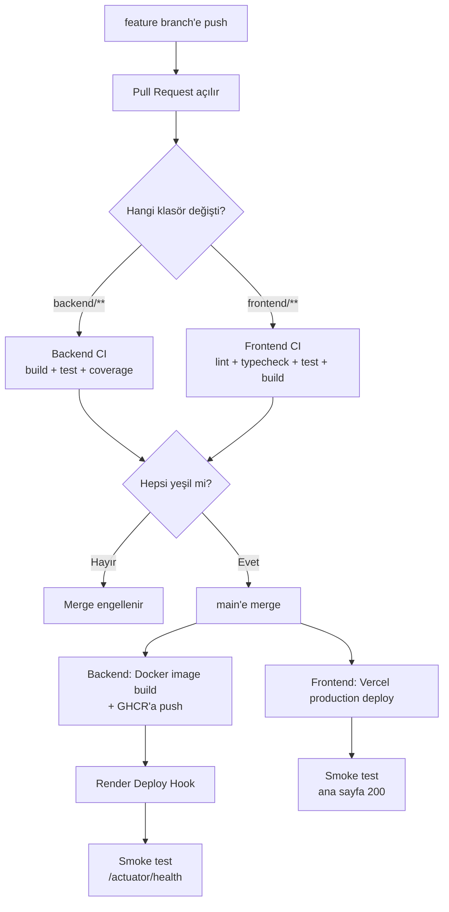

# 6. CI/CD

Araç: **GitHub Actions** (public repoda ücretsiz ve sınırsız dakika). Kodun GitHub'da olduğunu varsayıyoruz; Render ve Vercel GitHub ile doğrudan entegre olur.

## Hedef

- Her PR'da backend ve frontend testleri otomatik koşsun, kırmızıysa merge edilemesin.
- `main`'e merge olunca **sadece testler geçerse** canlıya deploy olsun.
- Deploy sonrası canlı sistem otomatik kontrol edilsin (smoke test).

## Pipeline Akışı

## Branch Stratejisi (GitHub Flow)

- `main` her zaman deploy edilebilir durumda; doğrudan push yok.
- Her iş için kısa ömürlü branch: `feat/interview-create`, `fix/jwt-expiry`, `chore/ci`.
- Commit mesajları [Conventional Commits](https://www.conventionalcommits.org/) formatında: `feat: add answer evaluation endpoint`, `fix: clamp llm score`, `test: add quota service tests`, `ci: add backend workflow`.
- GitHub → Settings → Branches → `main` için **branch protection / ruleset**:
  - Require a pull request before merging
  - Require status checks to pass → `backend-test`, `frontend-test` job'larını seç
  - Block force pushes

Tek başına çalışıyorsan bile PR aç: repo geçmişinde düzgün PR'lar görmek işe alımcılar için iyi bir sinyal.

## Workflow 1: Backend (`.github/workflows/backend.yml`)

**Tetikleyiciler:** `pull_request` ve `push` (`main`), sadece `backend/**` veya bu workflow dosyası değişince (`paths` filtresi). Elle çalıştırmak için `workflow_dispatch` de ekle.

**Genel ayarlar:** `defaults.run.working-directory: backend`, aynı branch'te yeni push gelince eski çalışmayı iptal etmek için `concurrency` grubu (`cancel-in-progress: true`).

### Job `backend-test` (her PR ve push)

| # | Adım | Nasıl | Not |
|---|---|---|---|
| 1 | Kodu çek | `actions/checkout` | |
| 2 | Java 21 kur | `actions/setup-java` → `distribution: temurin`, `java-version: 21`, `cache: maven` | Maven cache build'i dakikalarca hızlandırır |
| 3 | Test + paketle | `./mvnw -B verify` | `-B` batch mod, log kirliliğini azaltır |
| 4 | Ortam değişkenleri | `LLM_PROVIDER=mock`, `JWT_SECRET=` test için rastgele 32+ karakter | **CI'da gerçek Groq anahtarı yok**, kota harcanmaz |
| 5 | Test raporu | `actions/upload-artifact` ile `target/surefire-reports` ve `target/site/jacoco` | Başarısız testte raporu indirip bakabilirsin |

- **Testcontainers** GitHub'ın `ubuntu-latest` runner'ında ek ayar olmadan çalışır (Docker kurulu gelir). Ayrı bir `services: postgres` tanımlamana gerek yok.
- Coverage için `jacoco-maven-plugin` ekle; `verify` fazında rapor üretsin. İstersen minimum %60 satır kapsamı kuralı koy (`check` goal).

### Job `backend-docker` (sadece `main`'e push, `needs: backend-test`)

| # | Adım | Nasıl |
|---|---|---|
| 1 | Checkout | `actions/checkout` |
| 2 | GHCR'a giriş | `docker/login-action` → registry `ghcr.io`, kullanıcı `github.actor`, şifre `GITHUB_TOKEN` |
| 3 | Build + push | `docker/build-push-action` → context `./backend`, tag'ler `ghcr.io/<kullanıcı>/interviewpilot-backend:latest` ve `:<commit-sha>` |
| 4 | Cache | `cache-from/cache-to: type=gha` (katman cache'i) |

- Job'a `permissions: packages: write, contents: read` ver.
- Bu adım deploy için şart değil (Render kendisi de build edebilir), ama "her commit'in versiyonlanmış bir imajı var, geri dönmek istersem SHA ile dönerim" demeni sağlar. Portfolyoda güçlü bir detay.

### Job `backend-deploy` (sadece `main`, `needs: backend-docker`)

| # | Adım | Nasıl |
|---|---|---|
| 1 | Render'ı tetikle | `curl -fsS -X POST "$RENDER_DEPLOY_HOOK_URL"` (secret'tan) |
| 2 | Deploy'un bitmesini bekle + smoke test | `https://<servis>.onrender.com/actuator/health` adresine 20 sn arayla 15 kez istek at; `"status":"UP"` görünce başarılı, görmezse job kırmızı |

- `environment: production` tanımla → GitHub'da deploy geçmişi "Environments" sekmesinde görünür. İstersen manuel onay (required reviewers) ekleyebilirsin.
- Render'ın ücretsiz planında build ~3–5 dk, soğuk açılış ~1 dk sürer; smoke test bekleme süresini buna göre ayarla.

## Workflow 2: Frontend (`.github/workflows/frontend.yml`)

**Tetikleyiciler:** `pull_request` ve `push` (`main`), sadece `frontend/**` değişince.

### Job `frontend-test`

| # | Adım | Komut |
|---|---|---|
| 1 | Checkout | `actions/checkout` |
| 2 | Node 22 kur | `actions/setup-node` → `node-version: 22`, `cache: npm`, `cache-dependency-path: frontend/package-lock.json` |
| 3 | Bağımlılıklar | `npm ci` (lock dosyasına birebir uyar, `npm install` değil) |
| 4 | Lint | `npm run lint` |
| 5 | Tip kontrolü | `npx tsc -b` (veya `npm run typecheck`) |
| 6 | Test | `npx vitest run` |
| 7 | Build | `npm run build` (`VITE_API_URL` build'de gerekli, CI için sahte bir değer ver) |

### Job `frontend-deploy` (sadece `main`, `needs: frontend-test`)

İki seçenek var:

| Seçenek | Nasıl | Artı | Eksi |
|---|---|---|---|
| **A. Vercel CLI (önerilen)** | Vercel'in otomatik Git deploy'unu kapat. Actions'ta: `npm i -g vercel` → `vercel pull --yes --environment=production` → `vercel build --prod` → `vercel deploy --prebuilt --prod` | Deploy gerçekten testlere bağlı; pipeline tek yerden yönetiliyor | 3 secret gerekir |
| B. Vercel Git entegrasyonu | Vercel projeyi repoya bağlar, her push'ta kendisi deploy eder, PR'lara preview URL yorumlar | Sıfır ayar | Testler kırmızı olsa da deploy olur |

Seçenek A için:
- Vercel otomatik deploy'unu kapatmak: `frontend/vercel.json` içinde `git.deploymentEnabled: false`.
- Vercel ID'leri: lokalde `frontend/` klasöründe `vercel link` çalıştır → `.vercel/project.json` içinde `orgId` ve `projectId` çıkar (bu klasörü commit'leme).
- Smoke test: deploy sonrası production URL'ye `curl -fsS` → 200 dönmeli.

## Secret'lar

GitHub → repo → Settings → Secrets and variables → Actions:

| Secret | Nereden | Kullanan |
|---|---|---|
| `RENDER_DEPLOY_HOOK_URL` | Render → servis → Settings → Deploy Hook | `backend-deploy` |
| `VERCEL_TOKEN` | Vercel → Account Settings → Tokens | `frontend-deploy` |
| `VERCEL_ORG_ID` | `.vercel/project.json` | `frontend-deploy` |
| `VERCEL_PROJECT_ID` | `.vercel/project.json` | `frontend-deploy` |

Variables (gizli olmayan):

| Variable | Örnek |
|---|---|
| `BACKEND_URL` | `https://interviewpilot-api.onrender.com` |
| `FRONTEND_URL` | `https://interviewpilot.vercel.app` |

`GITHUB_TOKEN` otomatik gelir, eklemene gerek yok. `GROQ_API_KEY`, `DB_*`, `JWT_SECRET` GitHub'a **değil**, sadece Render'a eklenir (CI bunlara ihtiyaç duymaz).

## Dockerfile (backend) — tasarım

Multi-stage build kullan:

| Aşama | Base image | İş |
|---|---|---|
| 1. build | `eclipse-temurin:21-jdk` | `pom.xml` + `.mvn` kopyala → `./mvnw dependency:go-offline` (bağımlılık katmanı cache'lensin) → `src` kopyala → `./mvnw -DskipTests package` |
| 2. run | `eclipse-temurin:21-jre` | Sadece jar'ı kopyala, root olmayan kullanıcıyla çalıştır, `EXPOSE 8087` |

Önemli ayarlar:
- Render ücretsiz plan **512 MB RAM** verir. JVM'i buna göre sınırla: `JAVA_TOOL_OPTIONS="-XX:MaxRAMPercentage=75 -XX:+UseSerialGC -Xss512k"`. Aksi halde bellek aşımıyla (OOM) servis yeniden başlar.
- Uygulama `PORT` ortam değişkenini dinlemeli (`server.port: ${PORT:8087}`); Render bu değişkeni kendisi verir.
- Testler CI'da koştuğu için Docker build içinde `-DskipTests` kullan.
- `.dockerignore`: `target/`, `.idea/`, `*.iml`, `.env`.

## Ekstralar (zaman kalırsa)

| Ekstra | Ne işe yarar | Maliyet |
|---|---|---|
| README badge'leri | Actions durum rozeti (`backend`, `frontend`) | 2 dk |
| Dependabot (`.github/dependabot.yml`) | Maven, npm ve GitHub Actions bağımlılıkları için haftalık güncelleme PR'ları | 5 dk |
| CodeQL | GitHub'ın ücretsiz güvenlik taraması (Java + TypeScript) | 5 dk |
| PR şablonu | `.github/pull_request_template.md`: ne değişti, nasıl test edildi | 5 dk |
| Release | `main`'e tag atınca (`v1.0.0`) GitHub Release notları | 10 dk |

## Sık Karşılaşılan CI Hataları

| Hata | Sebep | Çözüm |
|---|---|---|
| `./mvnw: Permission denied` | Wrapper çalıştırma izni git'e kaydedilmemiş | `git update-index --chmod=+x backend/mvnw` |
| Testcontainers "Could not find a valid Docker environment" | Self-hosted veya Docker'sız runner | `ubuntu-latest` kullan |
| `JWT_SECRET` yok hatası (context yüklenemedi) | Test profili değişkeni bulamıyor | Workflow'da `env:` ile ver veya `application-test.yml`'e test değeri koy |
| `npm ci` lock hatası | `package-lock.json` güncel değil / commit'lenmemiş | Lokalde `npm install` → lock dosyasını commit'le |
| Frontend build'de `VITE_API_URL` undefined | Vite env değişkenleri build anında gömülür | CI'da ve Vercel'de değişkeni tanımla |
| Deploy hook 200 döndü ama site eski | Render hâlâ build ediyor | Smoke test'te bekleme/deneme sayısını artır |
